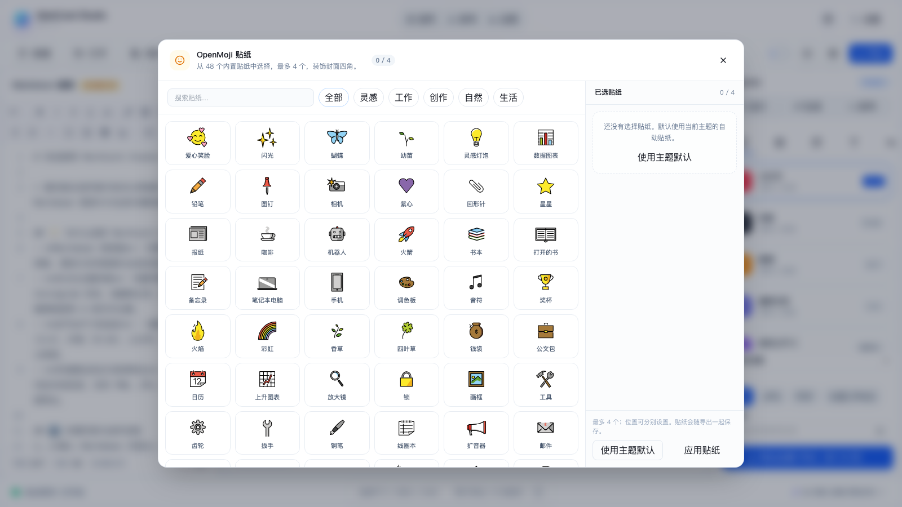

# OpenMoji 贴纸扩展

> 状态：已实施（2026-10-21）
> 范围：48 个内置 OpenMoji SVG、贴纸目录/分类、封面贴纸选择器、四角位置、持久化。
> 不包含：自由拖拽/缩放/旋转、任意页贴纸、图集内联贴纸。这些留给后续素材库/图集阶段。

---

## 1. 做了什么

| 能力 | 说明 |
| --- | --- |
| 素材扩充 | 从 16 个增加到 48 个 SVG，覆盖灵感、工作、创作、自然、生活 5 类 |
| 目录 | `src/config/openmoji.js`：id、文件名、中英文名、分类、关键词 |
| 贴纸选择器 | 工具栏笑脸按钮打开；搜索、分类、多选、最多 4 个 |
| 位置 | 每个贴纸可独立设置左上/右上/左下/右下 |
| 主题默认 | 不选贴纸时，继续使用主题自动贴纸；可一键恢复 |
| 持久化 | 选择写入 `markcard_studio_settings_v1` 的 `coverStickerSelection` |
| 预览/导出 | `CardArtwork` 优先使用页面自定义贴纸；导出沿用现有 `img.cover-sticker` 光栅化流程 |
| 许可 | 保留 OpenMoji CC BY-SA 4.0 署名；`public/stickers/openmoji/README.md` 已更新 |

## 2. 使用方式

1. 工具栏点击笑脸图标「OpenMoji 贴纸」；
2. 搜索或选分类；
3. 点选最多 4 个贴纸；
4. 在右侧「已选贴纸」里为每个贴纸选位置；
5. 点「应用贴纸」；
6. 想恢复主题默认，点「使用主题默认」。

贴纸只作用于封面（当前 `page.cover`），不会影响内页。

## 3. 文件

**新增**

- `src/config/openmoji.js`：48 个贴纸目录、分类、搜索
- `src/components/StickerPickerDialog.vue`：选择器
- `public/stickers/openmoji/*.svg`：新增 32 个 SVG（共 48）

**修改**

- `src/config/coverStickers.js`：主题默认贴纸改为引用目录
- `src/composables/useStudioDocument.js`：贴纸选择、持久化、页面 `stickers`
- `src/components/preview/CardArtwork.vue`：优先渲染页面自定义贴纸
- `src/components/AppToolbar.vue`：笑脸入口
- `src/App.vue`：选择器挂载
- `src/composables/useWorkspaceUi.js`：选择器开关
- `src/styles/themes/cover-stickers.css`：新增 `top-left` 位置
- `src/i18n/zh-CN.js` / `en-US.js`：OpenMoji 文案
- `public/stickers/openmoji/README.md`：数量、来源、许可

## 4. 界面




## 5. 验证

```bash
pnpm build      # 通过
cargo check --manifest-path src-tauri/Cargo.toml  # 通过（无 Rust 改动）
```

浏览器手动检查：

- 48 个贴纸全部加载，分类/搜索可用；
- 选择 2 个贴纸并应用，封面显示对应 SVG；
- 刷新页面后贴纸选择仍在（localStorage）；
- 选择「使用主题默认」可恢复主题贴纸；
- 控制台无新异常。

## 6. 已知限制

- 仅封面贴纸，不是任意页/图集内联贴纸；
- 只能选四角位置，不能自由拖拽、缩放、旋转；
- 贴纸选择是全局封面配置，不是每页独立；
- 导出沿用现有 cover-sticker 光栅化；未单独跑一次完整导出回归，建议在 Phase 2 导出测试时覆盖。

## 7. 后续

- 把贴纸接入素材库，成为可搜索的素材类型；
- 图集页支持内联贴纸/贴纸图层；
- 支持拖拽定位、缩放、旋转、透明度；
- 贴纸收藏/最近使用；
- 如果需要更多 OpenMoji，继续在目录中追加，并保留 CC BY-SA 署名。
