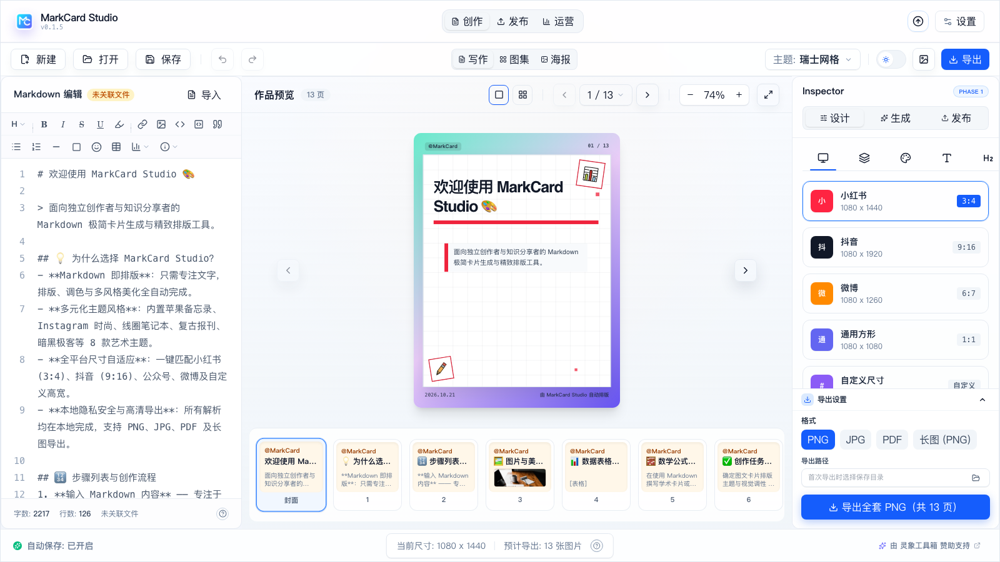
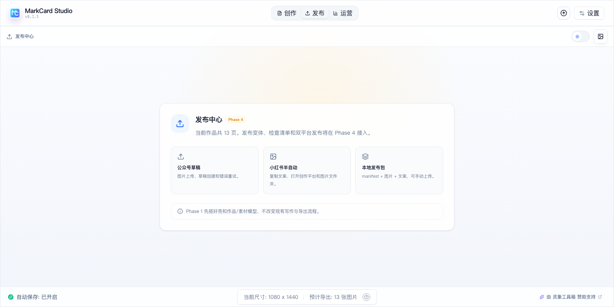
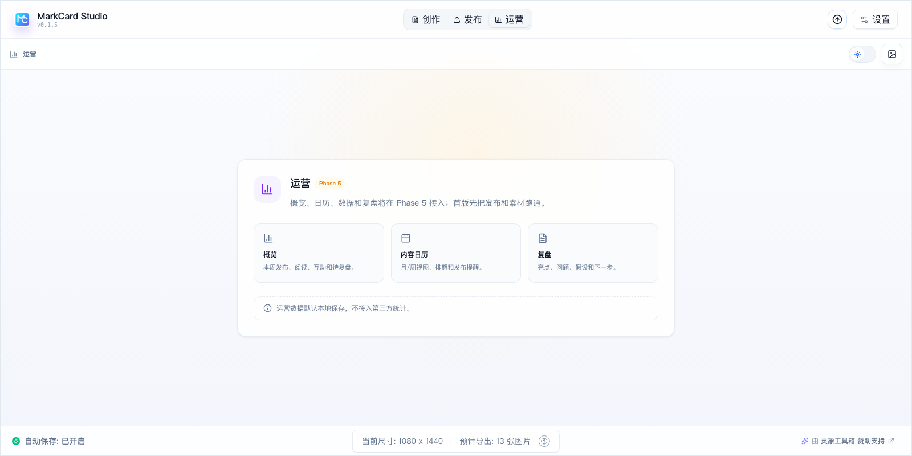
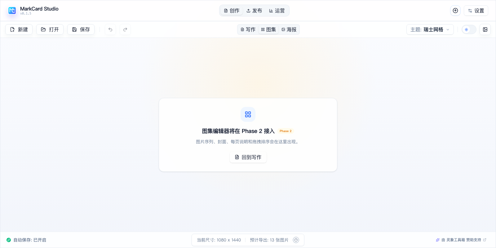
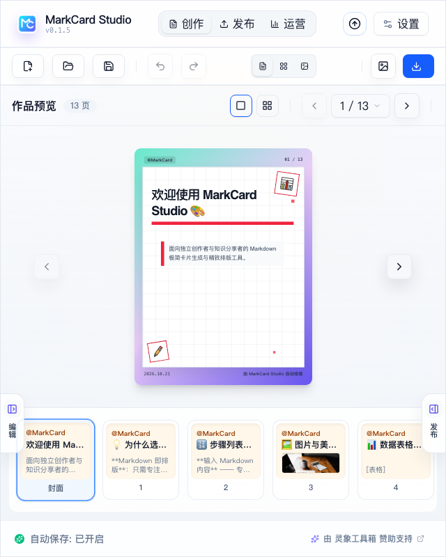

# Phase 1 实施记录：壳、Inspector 与模型骨架

> 状态：已实施（2026-10-21）
> 范围：3+1 工作区壳、Inspector 三段、合并重复 SettingsPanel、`useWorkspaceUi`、作品/素材模型骨架。
> 不包含：素材库正式 UI、封面工坊、发布流程、运营、Jaaz。它们按 Phase 2–F 推进。
> 后续：Phase 2 已完成，素材库/图集限制见 [`phase-2-implementation.md`](./phase-2-implementation.md)。

---

## 1. 已完成

| 能力 | 实现 |
| --- | --- |
| 3+1 导航 | 标题栏「创作 / 发布 / 运营」切换；素材库作为全局浮层入口 |
| 创作子模式 | 工具栏「写作 / 图集 / 海报」；图集/海报先显示 Phase 2 占位 |
| Inspector | 右栏「设计 / 生成 / 发布」三段；设计段嵌入现有 5 个设置 tab |
| 合并重复面板 | 停靠 + 抽屉共用 `InspectorPanel`，通过 `v-bind`/`v-on` 传参，去掉两份 SettingsPanel 大段重复 |
| UI 状态 | `useWorkspaceUi`：工作区、创作模式、Inspector 段位；持久化 `markcard_ui_v1` |
| 键盘 | `⌘1/2/3` 切换创作/发布/运营 |
| 占位工作区 | 发布中心（Phase 4）、运营（Phase 5）、图集/海报（Phase 2） |
| 素材库占位 | 工具栏素材按钮打开 Phase 2 占位浮层 |
| 作品/素材模型 | `useWork`、`useAssetLibrary` 骨架，定义 Work/Variant/Asset 形状；Phase 2 接入真实数据 |
| 响应式 | 1280/1024/820/640 下工具栏、预览头、状态栏不溢出；窄屏保留抽屉 |

## 2. 新增/修改文件

**新增**

- `src/components/WorkspaceSwitcher.vue`
- `src/components/InspectorPanel.vue`
- `src/components/CreationModePlaceholder.vue`
- `src/components/AssetLibraryPlaceholder.vue`（Phase 2 已替换为正式素材库并删除）
- `src/components/workspaces/PublishWorkspace.vue`
- `src/components/workspaces/OpsWorkspace.vue`
- `src/composables/useWorkspaceUi.js`
- `src/composables/useWork.js`
- `src/composables/useAssetLibrary.js`

**修改**

- `src/App.vue`：接入工作区壳、条件布局、Inspector 绑定、素材库占位、快捷键
- `src/components/AppTitlebar.vue`：工作区切换
- `src/components/AppToolbar.vue`：创作子模式、素材入口、窄屏动作
- `src/components/SettingsPanel.vue`：支持 `embedded`，去掉重复头部
- `src/components/AppStatusbar.vue`：窄屏隐藏中间信息
- `src/components/preview/PreviewHeader.vue`：窄屏隐藏缩放/全屏，避免标题竖排
- `src/i18n/zh-CN.js` / `en-US.js`：workspace/inspector/assets 文案

## 3. 验证

```bash
pnpm build      # 通过（仅既有 chunk size 警告）
cargo check --manifest-path src-tauri/Cargo.toml  # 通过
```

浏览器模式（`pnpm dev` + Chrome）手动检查：

- 1600×1000：三栏正常，写作/导出未回归；
- 1280×800：预览头不再竖排，工具栏图标化；
- 1024×800、820×800、640×800：工具栏/状态栏不横向溢出；
- 发布 / 运营 / 图集 / 素材库占位均可达；
- Inspector 设计/生成/发布切换正常；
- 控制台无运行时异常；仅有一条既有 i18n HTML 警告（`下划线 (<u>文本</u>)`）。

## 4. 界面截图

| 写作 | 发布中心 |
| --- | --- |
|  |  |

| 运营 | 图集占位 |
| --- | --- |
|  |  |

窄屏：



## 5. 已知限制

- 图集/海报只有占位，真正编辑器在 Phase 2；
- 素材库只有占位，导入/搜索/引用在 Phase 2；
- 发布中心/运营只有占位，真实流程在 Phase 4/5；
- Jaaz 不在 MVP，Phase F 再接；
- `useWork` / `useAssetLibrary` 只是模型骨架，尚未与 `useStudioDocument` 的数据流打通；
- 窄屏（<1024）隐藏主题快捷入口，后续可在设置/Inspector 中补；
- 未运行 `pnpm tauri dev` 的原生窗口检查；本轮只验证了浏览器模式与构建。

## 6. 下一阶段（Phase 2）

1. 把 `useWork` 接到当前文档/页面，生成真实 Work；
2. 素材库从占位变为网格/列表：导入、hash 去重、缩略图、搜索、引用；
3. 全局库 + 项目镜像的导入/替换/删除流程；
4. 图集模式从占位变为图片序列 + 封面 + Inspector 版式。

---

> 本轮没有改 Rust / Tauri 命令；`cargo check` 只用于确认现有 native 层未受影响。
