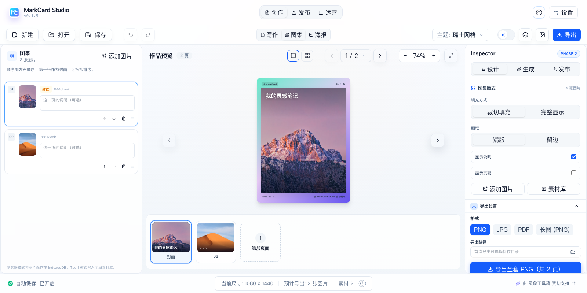
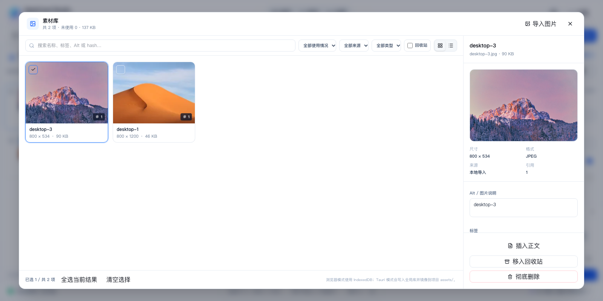

# Phase 2 实施记录：作品接线、素材库与图集

> 状态：已实施（2026-10-21）
> 范围：Work 数据接入、素材导入/去重/搜索/引用、全局库 + 项目镜像、图集序列编辑器、图集卡片渲染与导出。
> 不包含：封面工坊、图片编辑、发布包/微信草稿/小红书、运营、Jaaz。它们按 Phase 3–F 推进。

---

## 1. 已完成

| 能力 | 实现 |
| --- | --- |
| Work 接线 | `useWork` 持久化作品、来源、主题、画布、文案、图集图片与变体；App 随文档/主题/画布同步 |
| 素材存储 | Tauri 写入 `app_data/markcard/library`；浏览器用 IndexedDB，保证 `pnpm dev` 可测 |
| 导入/去重 | 文件选择、多选、拖拽式导入入口；SHA-256 内容寻址，重复导入直接复用 |
| 缩略图 | Canvas 生成最长边 320px 的 WebP（失败回退 PNG）；原生索引只存路径，按需加载 |
| 元数据 | 尺寸、格式、体积、来源、标签、Alt、版权、AI 标记、项目镜像路径、引用 |
| 搜索/筛选 | 名称、标签、Alt、hash；使用情况/来源/类型/回收站 |
| 网格/列表 | 4–5 列响应式网格、列表视图、多选、批量加入图集 |
| 详情 | 大图预览、Alt/标签/版权编辑、引用位置、移入回收站/恢复/彻底删除 |
| 引用完整性 | 被引用素材归档/删除时弹确认；支持强制操作 |
| 项目镜像 | 保存文档后，插入正文或加入图集时镜像到文档同目录 `assets/<hash>.<ext>` |
| 图集编辑 | 图片序列、封面标题、说明、拖拽排序、上移/下移、删除、素材库取图 |
| 图集版式 | 裁切填充/完整显示、满版/留边、显示说明、显示页码 |
| 图集导出 | 图集页复用 `CardArtwork.vue` + `useCardExport.js`，按平台尺寸导出 PNG/JPG/PDF |
| 空状态 | 图集、素材库、浏览器模式均有明确说明 |
| 桌面/浏览器差异 | 浏览器不生成项目镜像，UI 明确提示 IndexedDB 存储 |

## 2. 数据流

```text
Markdown / 当前文档
        │
        ├── useStudioDocument ── 写作模式：解析 + 真实测量分页
        │        │
        │        └── pages ── CardArtwork ── 预览 / 导出
        │
        └── useWork（Work / Variant / 图集图片）
                 │
                 ├── useAssetLibrary（assetId / usage / 项目镜像）
                 │        ├── Tauri: library/index.json + assets/ + thumbs/
                 │        └── Browser: IndexedDB
                 │
                 └── setGallerySource ── 图集模式：pages 由图片序列直接生成
                          │
                          └── CardArtwork（page.gallery）── 预览 / 导出
```

图集模式不经过 Markdown 测量分页：每张图对应一个 synthetic page，`page.gallery` 携带图片、说明、序号和版式。写作模式仍走原有 `useMeasuredPagination`，两种模式在切换时都会重建 `pages`。

## 3. 新增/修改文件

**新增**

- `src-tauri/src/assets.rs`：素材选择、索引读写、文件写入、读取、项目镜像、删除与 6 个存储单元测试
- `src/storage/assetRepository.js`：浏览器 IndexedDB 仓库
- `src/utils/imageFiles.js`：Data URL、SHA-256、尺寸、缩略图、格式化
- `src/components/assets/AssetLibraryDialog.vue`
- `src/components/assets/AssetCard.vue`
- `src/components/assets/AssetDetail.vue`
- `src/components/assets/AssetThumbnail.vue`
- `src/components/gallery/GallerySequencePanel.vue`
- `src/components/gallery/GalleryInspector.vue`
- `src/styles/themes/card-gallery.css`
- `docs/phase-2-implementation.md`

**修改**

- `src/composables/useAssetLibrary.js`：从骨架扩展为真实索引、导入、引用、回收站、镜像
- `src/composables/useWork.js`：作品持久化、图集图片、版式、来源同步
- `src/composables/useStudioDocument.js`：`setGallerySource`、图集 synthetic pages、模式切换重分页
- `src/components/preview/CardArtwork.vue`：`page.gallery` 满版/留边/说明/页码/缺失图占位，并跳过图集溢出误报
- `src/components/preview/PreviewStrip.vue`：图集缩略图
- `src/components/InspectorPanel.vue`：图集版式区
- `src/App.vue`：Work/素材接线、图集布局、素材选择器、模式切换、引用同步
- `src/components/AppToolbar.vue`、`AppStatusbar.vue`、`AppIcon.vue`
- `src/i18n/zh-CN.js`、`src/i18n/en-US.js`
- `src/styles/themes/index.css`
- `src-tauri/src/lib.rs`
- `docs/change-review-and-decisions.md`

## 4. 存储约定

### 4.1 全局库（Tauri）

```text
<appData>/markcard/library/
├── index.json
├── assets/ab/cd/<sha256>.<ext>
└── thumbs/ab/cd/<sha256>.<webp|png>
```

- `assetId` = `sha256:<64 hex>`；原图只在库中存一份。
- `index.json` 用临时文件 + rename 原子写；损坏时重命名为 `index.corrupt-<ts>.json` 并回退空库。
- 缩略图路径只存在索引中；网格按需调用 `read_asset_file`，避免一次加载全部 base64。
- EXIF 尚未剥离；当前原图按字节写入库（见限制）。

### 4.2 项目镜像

- 插入正文：`mirror_asset` 复制到 `<文档目录>/assets/<hash>.<ext>`，Markdown 写相对路径。
- 加入图集：文档已保存时同样镜像；图集页仍用 `assetId` + 库内原图渲染。
- 浏览器模式没有原生项目目录，插入正文会提示先保存文档；图集使用 IndexedDB 原图。
- 未使用绝对路径或符号链接。

### 4.3 浏览器

- `markcard-asset-library-v1` 数据库，`assets` object store，主键 `assetId`。
- 记录包含 `dataUrl`、`thumbDataUrl`、`usage`、`rights`、`tags` 等；写入前 JSON 深拷贝，避免 Vue Proxy 无法 structured clone。
- 作品元数据写 `markcard_works_v1`，当前作品 id 写 `markcard_current_work_v1`；图片 `src` 不持久化，加载后从素材库水合。

## 5. 验证

```bash
pnpm build                                              # 通过（仅既有 chunk size 警告）
cargo check --manifest-path src-tauri/Cargo.toml        # 通过
cargo test --manifest-path src-tauri/Cargo.toml         # 6 passed
pnpm tauri dev                                          # 原生窗口启动，1200×800 正常
```

浏览器（`pnpm dev` + Chrome）手动验证：

- 素材库空状态、导入 2 张图、重复导入去重（新增 0 / 重复 1）；
- 网格/列表、搜索、使用情况筛选、详情 Alt/标签/版权；
- 素材加入图集、封面标识、拖拽/上下移动、说明编辑、封面标题同步到 Markdown H1；
- 图集 1–2 页预览、裁切填充/完整显示、满版/留边、页码开关；
- 图集导出 2 页 PNG，尺寸 1080×1440，图片满版未被裁掉；
- 切回写作后恢复 13 页测量分页，原 Markdown 导出 13 张 PNG；
- 1600/1240/1180/1024/820/640 布局无横向溢出，素材弹窗 640px 可用；
- 刷新/重启浏览器后素材、引用、图集图片仍在；
- 控制台无运行时异常；仅既有 intlify HTML 警告。

### 界面截图

| 图集 | 素材库 |
| --- | --- |
|  |  |

## 6. 已知限制

1. 原生文件选择/导入没有做自动化端到端测试；`pick_asset_files`/`store_asset_file`/`mirror_asset` 已通过 Rust 编译与存储单元测试，原生窗口已启动验证，但仍需手动点一次真实导入确认。
2. 浏览器模式不能写项目 `assets/`；插入正文要求先保存 Markdown 文档。
3. 图集图片目前只支持素材库顺序、说明和版式；没有裁切焦点、单页多图、九宫格、长图切片。
4. 替换素材、批量标签、压缩/转格式、回收站 30 天自动清理尚未实现。
5. 原图写入库时未做 EXIF/GPS 剥离；发布前隐私处理留到 Phase 4。
6. 素材索引是 JSON，搜索在内存完成；<5,000 素材的 MVP 规模可用，更大规模需迁移 SQLite。
7. 图集页的 `page.gallery` 是 synthetic page，不经过测量分页；写作模式的测量分页不变。
8. `.mcard` 打包、发布包和跨机器迁移尚未实现。

## 7. 下一阶段（Phase 3）

1. 封面工坊：模板、安全区、确定性背景、文字/贴纸叠层；
2. 图集增强：焦点裁切、单页多图、九宫格/长图切片；
3. 图片编辑：裁切/旋转、滤镜、马赛克、标注；
4. 素材替换与版本关系；
5. `ImageProvider` 接口骨架（仍不接 Jaaz）。
