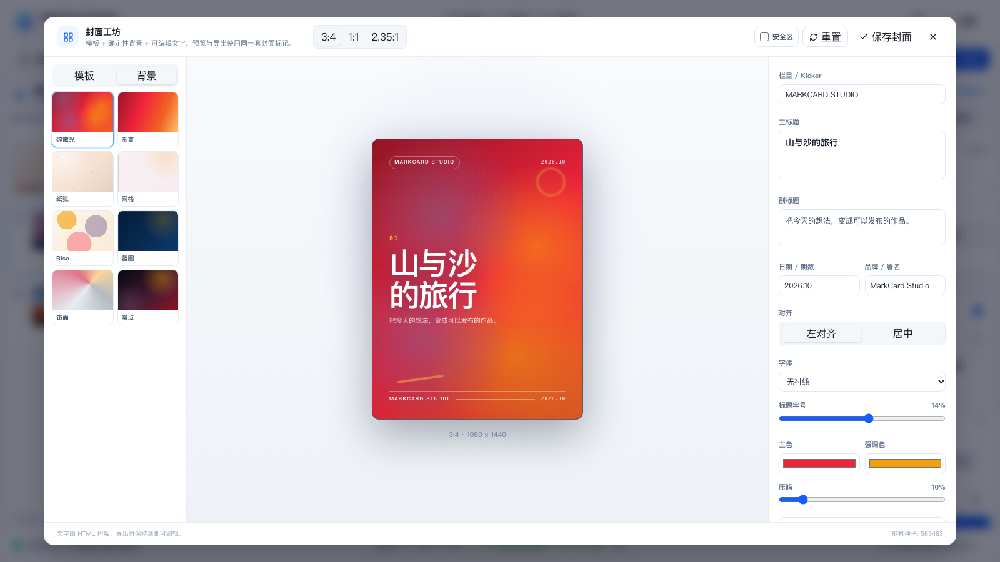
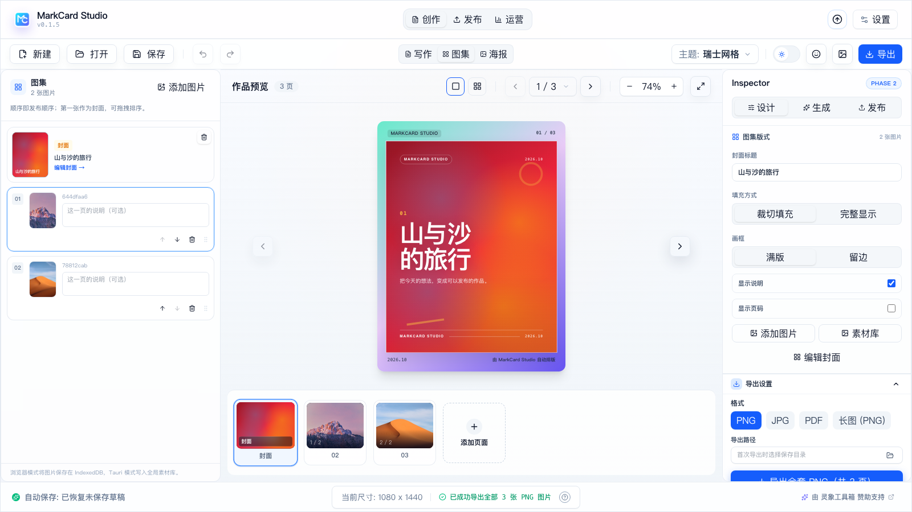
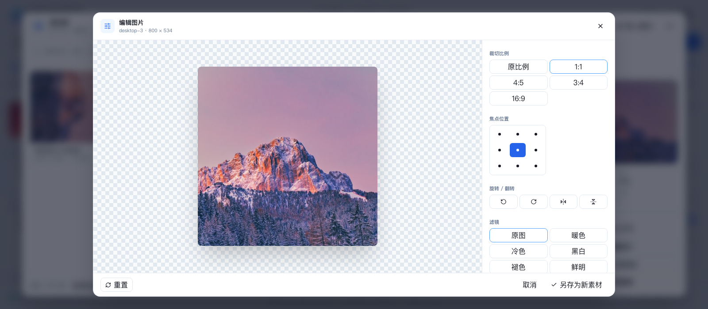

# Phase 3 实施记录：封面工坊、确定性背景与图片编辑

> 状态：已实施（2026-10-21）
> 范围：封面工坊（模板/背景/文字/安全区）、确定性背景生成器、封面进入图集、轻量图片编辑、封面导出。
> 不包含：拼图/九宫格/长图切片、图表/截图美化、AI 生图、发布包与运营。它们按 Phase 4–F 推进。

---

## 1. 已完成

| 能力 | 实现 |
| --- | --- |
| 封面工坊 | 全屏三栏：模板/背景、实时预览、内容/排版/颜色；保存后回到图集 |
| 8 套模板 | 编辑网格、杂志、手帐、极简、终端科技、拼贴、渐变宣言、电影海报 |
| 8 种确定性背景 | 弥散光、渐变、纸张、网格、Riso、蓝图、铬面、噪点；seed 可复现 |
| 封面比例 | 3:4 / 1:1 / 2.35:1 预览与画布尺寸提示 |
| 安全区 | 预览可显示虚线安全区，标题不进入危险区 |
| 文字排版 | 栏目、主标题、副标题、日期/期数、品牌/署名；左/居中；字体、字号、压暗、主色/强调色 |
| 封面进入图集 | 设计封面作为图集第 1 页；图片从第 2 页开始；未设计时仍使用第一张图片作封面 |
| 移除封面 | 图集封面卡可移除设计，回退到首图封面 |
| 封面导出 | 复用 `CardArtwork` + `useCardExport`，封面页与图片页同一套导出 |
| 图片编辑 | 裁切比例、焦点位置、旋转、水平/垂直翻转、6 种滤镜 |
| 另存为新素材 | 编辑结果写入素材库，保留原图，`source.kind = "edited"` 与 `derivedFrom` |
| 响应式 | 封面工坊 1024 三栏；820/640 纵向滚动；图片编辑窄屏上下布局 |

## 2. 数据模型

```js
work.coverDesign = {
  schemaVersion: 1,
  templateId: "editorial",
  ratio: "3:4",
  title: "山与沙的旅行",
  subtitle: "把今天的想法，变成可以发布的作品。",
  kicker: "MARKCARD STUDIO",
  meta: "2026.10",
  brand: "MarkCard Studio",
  background: {
    style: "mesh",
    seed: 563483,
    baseColor: "#ef233c",
    accentColor: "#f59e0b",
  },
  layout: {
    align: "left",
    font: "sans",
    titleScale: 0.145,
    padding: 0.08,
    safeArea: 0.06,
    overlay: 0.1,
    uppercaseKicker: true,
    textColor: "",
    accentColor: "",
  },
}
```

- `coverDesign` 存于 Work，随 `markcard_works_v1` 持久化。
- 封面页是 synthetic page：`page.coverDesign`，仍由 `CardArtwork.vue` 渲染。
- 背景不存截图，只存 `style + seed + palette`，重新打开时确定性重建。
- 图片编辑结果按内容 hash 入库，保留原图；`source.derivedFrom` 指向原素材。

## 3. 关键文件

**新增**

- `src/config/coverTemplates.js`：模板、比例、默认排版、背景风格清单
- `src/utils/coverBackgrounds.js`：确定性 CSS 背景生成器、seed、色板
- `src/composables/useCoverStudio.js`：封面状态、模板应用、内容/排版/背景更新
- `src/components/cover/CoverDesignArtwork.vue`：封面视觉标记
- `src/components/cover/CoverPreview.vue`：按比例缩放预览
- `src/components/cover/CoverStudioDialog.vue`：全屏三栏编辑器
- `src/components/assets/ImageEditorDialog.vue`：裁切/焦点/旋转/翻转/滤镜
- `src/utils/imageEditor.js`：Canvas 裁切/旋转/翻转/滤镜管线
- `src/styles/themes/cover-design.css`：封面模板与缩略图样式
- `docs/phase-3-implementation.md`

**修改**

- `src/components/preview/CardArtwork.vue`：`page.coverDesign` 渲染、封面不误报溢出、隐藏封面贴纸
- `src/composables/useStudioDocument.js`：图集 synthetic pages 支持封面设计
- `src/composables/useWork.js`：`coverDesign` 持久化、`setCoverDesign`、标题同步
- `src/components/gallery/GallerySequencePanel.vue`：封面卡、设计/编辑/移除封面
- `src/components/gallery/GalleryInspector.vue`：编辑封面入口
- `src/components/InspectorPanel.vue`、`App.vue`：封面工坊接线、打开/保存/移除
- `src/components/assets/AssetDetail.vue`、`AssetLibraryDialog.vue`：编辑图片入口与另存为新素材
- `src/composables/useAssetLibrary.js`：`edited` 来源与 `derivedFrom`
- `src/composables/useWorkspaceUi.js`：`coverStudioOpen`
- `src/components/AppIcon.vue`：翻转图标
- `src/i18n/zh-CN.js`、`en-US.js`：封面/图片编辑文案
- `src/composables/useCardExport.js`：封面页跳过滚动区误判

## 4. 验证

```bash
pnpm build                                              # 通过（仅既有 chunk size 警告）
cargo check --manifest-path src-tauri/Cargo.toml        # 通过
cargo test --manifest-path src-tauri/Cargo.toml         # 6 passed
pnpm tauri dev                                          # 原生窗口 1200×800 启动，UI 正常
```

浏览器手动验证：

- 打开封面工坊，切换模板/背景，保存后图集从 2 页变为 3 页（封面 + 2 图）；
- 封面页导出 1080×1440，标题为白色，未被主题 h1 样式覆盖；
- 纸张背景（CSS-only 纹理）导出成功，不再依赖 SVG data URL；
- 移除封面设计后回到 2 页，首图重新成为封面；
- 图片编辑：1:1 裁切、暖色滤镜、旋转 90°，另存为 2400×2400 新素材；
- 素材库出现 `desktop-3-edited`，来源为“编辑生成”，原图保留；
- 封面工坊 1024 三栏、820/640 纵向滚动，无横向溢出；
- 控制台无运行时异常。

### 界面截图

| 封面工坊 | 封面进入图集 |
| --- | --- |
|  |  |



## 5. 已知限制

1. 封面页面会适配当前图集画布；1:1 / 2.35:1 目前用于设计和预览，独立的裁切/封面资源导出尚未实现。
2. 封面工坊没有自由拖拽图层、文字旋转、图片背景、Logo 上传、A/B 候选；这些留到后续。
3. 图片编辑是固定比例 + 焦点裁切，不是自由裁切框；没有画笔/文字/马赛克/局部模糊。
4. 编辑结果固定输出 PNG，2400px 长边；大图会产生较大文件。
5. 封面设计不进入素材库；发布包和 `.mcard` 还未实现。
6. 确定性背景是 CSS 生成，不是位图；部分复杂纹理（真实噪点、纸张纤维）是近似效果。
7. EXIF/GPS 剥离仍未做。

## 6. 下一阶段（Phase 4）

1. 发布变体：标题/正文/标签/图片顺序/封面覆盖；
2. 发布检查：尺寸、数量、标题长度、版权/缺图；
3. 发布包：manifest + images + copy + checks；
4. 微信公众号草稿、小红书半自动；
5. `.mcard` 打包与项目迁移。
