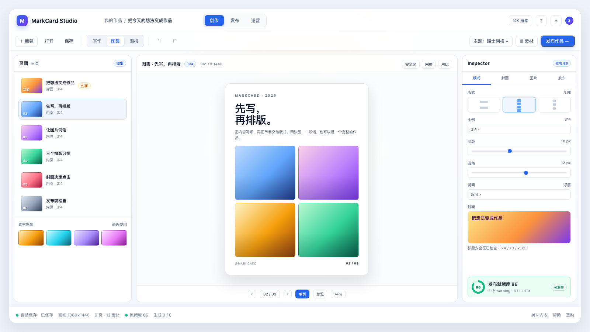
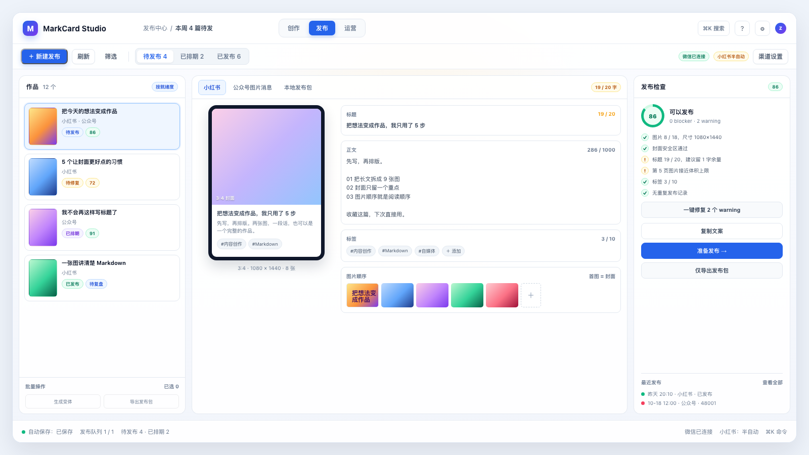
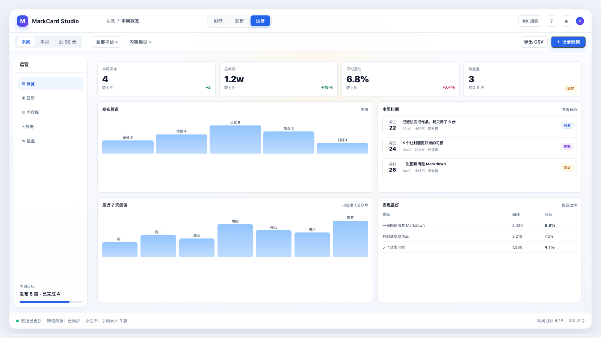
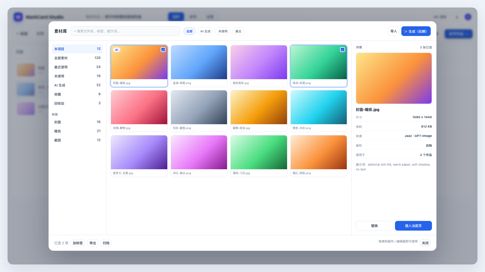
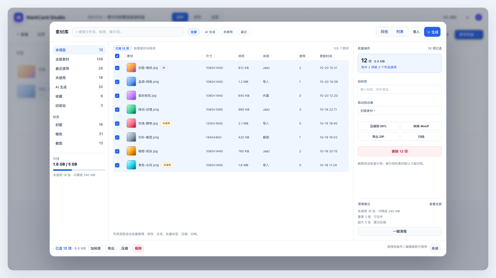
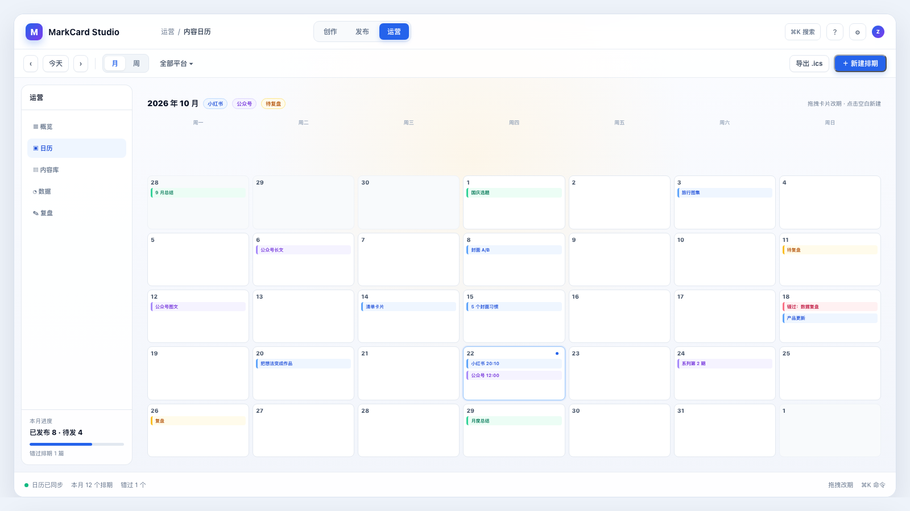
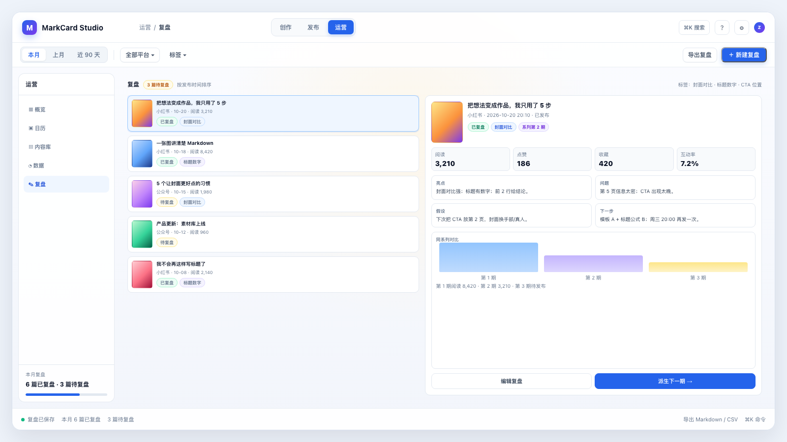

# MarkCard Studio UI 架构设计

> 状态：设计稿（Phase 1–3 已实施，其余未实施）
> 日期：2026-10-20
> 关系：本文是 [`image-content-suite-design.md`](./image-content-suite-design.md) 的 UI 细化，重点回答「这些能力放在哪里、怎么切换、怎么不打架」。
> 实施：3+1 壳、Inspector、素材库浮层、图集序列、封面工坊与图片编辑已落地，见 [`phase-1-implementation.md`](./phase-1-implementation.md)、[`phase-2-implementation.md`](./phase-2-implementation.md)、[`phase-3-implementation.md`](./phase-3-implementation.md)；发布/运营仍为设计。
> 范围：全局壳、创作（写作/图集/海报）、素材库、封面工坊、Jaaz 生成（后期）、发布中心、运营、设置、响应式与组件架构。
> 非目标：像素级视觉稿、动效分镜、品牌 VI 重设计；视觉语言沿用现有 Tailwind + DaisyUI 体系。

---

## 0. 结论先行

### 0.1 推荐架构：3 + 1

```text
一级工作区：创作 / 发布 / 运营
创作内部：  写作 / 图集 / 海报
全局浮层：  素材库
```

**不把「写作 / 图集」做成一级导航**，理由：

- 写作和图集共享主题、画布、预览、导出、素材库，本质是「创作」的两种输入方式；
- 一级同时出现「发布」模式和「发布」按钮，语义会打架；
- 3 个一级入口更稳定，未来加「视频」也不用挤导航；
- 素材库是跨模式工具，做成全局浮层比做成一级页面更顺手。

> 主设计文档 2.4 已同步收敛为 3+1；具体线框、组件与交互以本文为准。

### 0.2 八条 UI 决策

1. **保留现有三栏骨架**：左栏上下文、中间画布、右栏 Inspector；不新增第四列。
2. **右栏从「设置面板」升级为「上下文 Inspector」**：`设计 / 生成 / 发布` 三段，设计段内再放 5 个设置 tab（平台/分页/背景/标头/排版）。
3. **快速发布用弹窗，发布管理用一级工作区**：当前作品「发布作品…」开三步弹窗；批量、队列、历史去「发布」工作区。
4. **素材库、封面工坊、设置用全屏浮层**：保留当前上下文，`Esc` 关闭，不打断编辑。
5. **Jaaz 生成放在 Inspector 的「生成」页（后期）**：MVP 只留入口占位；接入后窄栏放提示词和结果列表，点「展开」变 480px 抽屉；封面工坊里用紧凑弹层。
6. **状态栏常驻「发布就绪度」**：用户随时知道还差什么，而不是点发布才报错。
7. **键盘优先**：`⌘K` 命令面板、`⌘1/2/3` 切工作区、`⌘⇧A` 素材库、`⌘⇧G` 生成、`⌘Enter` 发布。
8. **响应式不重做一套 UI**：沿用现有 1240/1180 停靠阈值，窄屏用抽屉/底部面板，弹窗全屏化。

### 0.3 一张图看懂

```text
┌────────────────────────────────────────────────────────────────────────────┐
│ Logo  MarkCard Studio   [ 创作 ] [ 发布 ] [ 运营 ]        ⌘K   ?   ⚙        │  64
├────────────────────────────────────────────────────────────────────────────┤
│ [新建][打开][保存] │ [写作|图集|海报] │ [撤销][重做]   [主题▾] [素材] [发布作品] │  48
├───────────────┬──────────────────────────────────────────┬─────────────────┤
│ 左栏           │ 中央画布                                  │ Inspector       │
│ 编辑/页面/列表 │ 预览 / 图集 / 变体 / 运营内容              │ 设计/生成/发布   │
│ 320–386       │ flexible                                  │ 300–360         │
├───────────────┴──────────────────────────────────────────┴─────────────────┤
│ 自动保存 · 画布 1080×1440 · 8 页 · 就绪度 86 · 赞助                          │  48
└────────────────────────────────────────────────────────────────────────────┘
```

### 0.4 界面预览（静态稿）

> 下面是结构示意，用来确认信息层级与布局，不是最终视觉稿；可交互 HTML 在 [`ui/mockups.html`](ui/mockups.html)，通过 `?screen=create|publish|ops|ops-calendar|ops-review|assets|assets-list` 切换。

| 创作 / 图集 | 发布中心 |
| --- | --- |
|  |  |

| 运营概览 | 素材库浮层 |
| --- | --- |
|  |  |

---

## 1. 目标、现状与约束

### 1.1 用户目标

| 用户意图 | UI 必须支持 |
| --- | --- |
| 继续写一篇 Markdown | 打开即写，写作体验不能被新功能打断 |
| 把长文变成图集 | 一键切到图集，保留内容、主题、画布 |
| 找一张图/生成一张图 | 素材库和生成面板随时可达，不离开当前作品 |
| 调封面 | 封面工坊全屏编辑，实时看 3:4 / 1:1 / 2.35:1 |
| 发小红书/公众号 | 当前作品一键发布；多平台变体可对比、可检查 |
| 看数据/复盘 | 运营工作区，不把报表塞进创作界面 |

### 1.2 现有 UI 审计

| 区域 | 现状 | 保留 | 问题/改造 |
| --- | --- | --- | --- |
| 标题栏 | 68px，仅品牌 | 品牌、窗口拖拽 | 加模式切换、作品面包屑、命令入口 |
| 工具栏 | 新建/打开/保存、撤销重做、主题、外观、设置、导出 | 文档动作、主题、导出 | 加创作子模式、素材、发布；按钮分组 |
| 左栏 | Markdown 编辑器，320–386px | 写作体验 | 图集/海报时要切换为页面条/素材托盘 |
| 中栏 | 预览画布，单页/总览 | WYSIWYG 画布 | 图集加封面/拖拽；发布加手机预览；运营加内容区 |
| 右栏 | 平台/分页/背景/标头 4 tab，300–332px | 设置项 | 升级为 Inspector：设计/生成/发布 |
| 底栏 | 自动保存、画布尺寸、页数、赞助 | 信息架构 | 加素材数、发布就绪度、任务进度 |
| 设置 | 全屏 Dialog | 独立设置 | 加生成/发布/素材/快捷键分区，改左侧导航 |
| 窄屏 | 左右抽屉 | 抽屉模式 | 增加底部模式切换；发布弹窗全屏 |

当前 `App.vue` 有两份 `SettingsPanel`（停靠 + 抽屉），props/emits 重复。UI 改造时顺手抽成 `InspectorPanel` + `v-bind`/`v-on`，否则新增字段会继续漏改。

### 1.3 技术约束

- Vue 3 `<script setup>`，JavaScript，无 Vue Router、无 Pinia、无 TypeScript。
- Tailwind CSS 4 + DaisyUI；现有视觉语言是「浅色玻璃面板 + 蓝色主色 + slate 文本 + 圆角 12px」。
- 预览与导出必须共用同一渲染结果；UI 不能引入第二套卡片 DOM。
- 所有文案走 `src/i18n/zh-CN.js` / `en-US.js`，两边同步。
- 浏览器模式必须降级，不能白屏。
- 现有 `App.vue` 514 行、`useStudioDocument.js` 1,295 行；新增域用新 composable，不继续膨胀。

### 1.4 设计原则

1. **画布优先**：任何面板展开都不能让画布跳变或遮住当前编辑位置。
2. **就地完成**：能在当前上下文完成的，不跳页面；必须跳的，提供明确返回路径。
3. **渐进披露**：默认只给最常用项，高级项收进「更多/高级」。
4. **一致的手感**：所有浮层 `Esc` 关闭、点击遮罩关闭、焦点回到触发按钮。
5. **状态可见**：保存、生成、上传、检查都有进度/结果/失败原因。
6. **不重复造组件**：素材选择、发布检查、空状态、进度条做成共享组件。

---

## 2. 信息架构

### 2.1 一级导航

| 一级 | 回答的问题 | 默认内容 | 主按钮 |
| --- | --- | --- | --- |
| **创作** | 我要做什么内容？ | 当前作品 + 画布 | 发布作品 / 导出 |
| **发布** | 哪些作品要发？发得怎么样？ | 作品列表 + 变体 + 检查 | 新建发布 / 重试 |
| **运营** | 发完之后效果如何？ | 概览/日历/数据/复盘 | 记录数据 / 新建排期 |

全局工具：

- 素材库（浮层）
- 命令面板（`⌘K`）
- 设置（浮层）
- 帮助/快捷键

### 2.2 站点地图

```text
MarkCard Studio
├─ 创作
│  ├─ 写作（Markdown → 卡片）
│  ├─ 图集（图片序列 + 封面 + 文案）
│  ├─ 海报（单图 + 标题/二维码）
│  ├─ 封面工坊（浮层）
│  ├─ Jaaz 生成（后期）
│  └─ 素材库（全局浮层）
├─ 发布
│  ├─ 待发布
│  ├─ 已排期
│  ├─ 已发布
│  ├─ 发布历史
│  ├─ 快速发布弹窗（从创作进入）
│  └─ 渠道设置（微信/小红书/本地包）
├─ 运营
│  ├─ 概览
│  ├─ 日历
│  ├─ 内容库
│  ├─ 数据
│  └─ 复盘
└─ 设置
   ├─ 通用/外观
   ├─ 生成（Jaaz，后期）
   ├─ 发布（微信/小红书）
   ├─ 素材（存储/缓存/EXIF）
   ├─ 快捷键
   └─ 关于/许可
```

### 2.3 模式切换规则

- 切换工作区不销毁文档状态；滚动位置、当前页、选中素材尽量保留。
- 有未保存修改时，切换不弹确认（自动保存/草稿已存在）；关闭应用才确认。
- 从「创作 → 发布」时，如果当前作品未就绪，直接打开该作品的变体检查，不阻止进入。
- 从「发布 → 创作」时，回到上次的创作模式和页面。
- 深链接暂不做路由；用 `activeWorkspace` + `creationMode` + `selectedWorkId` 持久化，未来可映射到 hash。

| 从 | 触发 | 到 | 返回方式 |
| --- | --- | --- | --- |
| 创作/写作 | 发布作品 | 快速发布弹窗 | 关闭回写作，保留光标/滚动 |
| 创作/图集 | 发布作品 | 快速发布弹窗 | 关闭回图集，保留当前页 |
| 快速发布弹窗 | 成功 | 发布中心/发布记录 | 「返回创作」回原页面 |
| 发布中心 | 查看数据 | 运营/数据 | 面包屑回发布中心 |
| 运营/内容库 | 打开作品 | 创作/对应模式 | 「返回运营」回列表 |
| 素材库 | 插入/设为封面 | 关闭浮层，回原上下文 | `Esc` 关闭不插入 |
| 封面工坊 | 保存 | 回图集/写作，封面已更新 | 取消丢弃未保存改动 |

### 2.4 入口矩阵

| 动作 | 入口 | 结果 |
| --- | --- | --- |
| 新建作品 | 工具栏「新建」/ 命令面板 | 选择写作/图集/海报 |
| 插入图片 | 编辑器粘贴/拖入、素材库「插入」、命令面板 | 入库 + 插入当前光标/页面 |
| 生成图片 | Inspector「生成」、封面工坊「AI 背景」、素材库「生成」 | 结果入库，按来源插入 |
| 编辑封面 | 图集左栏封面卡、Inspector「封面」、发布检查 | 打开封面工坊 |
| 发布 | 工具栏「发布作品」、发布工作区、命令面板 | 快速弹窗 / 发布中心 |
| 看数据 | 状态栏「查看数据」、发布成功 toast、运营工作区 | 对应作品数据/复盘 |
| 配置账号 | 发布工作区「渠道设置」、设置「发布」 | 凭据/权限/测试 |

---

## 3. 全局壳

### 3.1 结构

```text
AppShell
├─ AppTitlebar (64)
│  ├─ Brand
│  ├─ WorkBreadcrumb（作品名，可编辑）
│  ├─ WorkspaceSwitcher（创作/发布/运营）
│  └─ GlobalActions（⌘K、帮助、设置）
├─ AppToolbar (48)
│  ├─ DocumentActions
│  ├─ CreationModeSwitch（仅创作）
│  ├─ HistoryActions
│  └─ ContextActions（主题、素材、发布作品、更多）
├─ Workspace (flex)
│  ├─ WorkspaceSidebar（左栏）
│  ├─ WorkspaceCanvas（中栏）
│  └─ InspectorPanel（右栏）
├─ AppStatusbar (48)
└─ OverlayHost
   ├─ AssetLibraryDialog
   ├─ CoverStudioDialog
   ├─ PublishDialog
   ├─ CommandPalette
   └─ AppSettingsDialog
```

### 3.2 标题栏

- 高度 64px（比现在 68 少 4px，给工具栏和状态栏更多空间）。
- 左：Logo + 产品名。
- 中左：作品面包屑：`我的作品 / 把想法变成作品`，点击可重命名/切换最近作品。
- 中右：模式切换 segmented control（创作/发布/运营）。
- 右：`⌘K` 搜索按钮、帮助、设置。
- 窄屏：面包屑缩成图标，模式切换变下拉/底部 tab。

### 3.3 工具栏

按「文档 → 模式 → 历史 → 上下文」分组，组间用 1px 分隔线：

```text
[新建] [打开] [保存] │ [写作|图集|海报] │ [撤销] [重做] │ [主题▾] [素材] [预览] [发布作品]
```

- 创作/写作：显示文档动作、创作子模式、撤销重做、主题、素材、发布。
- 创作/图集：文档动作弱化为「导入/保存」，突出「添加图片、封面、批量」。
- 发布：显示「新建发布、刷新、筛选」，不显示主题。
- 运营：显示日期范围、平台筛选、导出。
- 主按钮只保留一个：`发布作品`（创作）/`新建发布`（发布）/`记录数据`（运营）。

### 3.4 模式切换

- 三段式，选中项蓝底白字或蓝色下划线；宽度足够时显示图标+文字。
- 快捷键：`⌘1` 创作、`⌘2` 发布、`⌘3` 运营。
- 切换时用 150ms 淡入/位移，避免整页闪。
- 不在模式切换里放「素材库」；素材库是全局浮层，避免一级导航过载。

### 3.5 Inspector

右栏不是「设置」，而是「当前对象的属性/检查」：

| 工作区 | Inspector 顶部段 | 内容 |
| --- | --- | --- |
| 创作/写作 | 设计 / 生成 / 发布 | 设计=现有 4 tab；生成=Jaaz（后期）；发布=就绪度摘要 |
| 创作/图集 | 版式 / 封面 / 图片 / 发布 | 版式、封面、焦点/说明、就绪度 |
| 创作/海报 | 设计 / 生成 / 发布 | 模板、文字、二维码、生成 |
| 发布 | 检查 / 历史 | 渠道检查、发布记录 |
| 运营 | 详情 | 选中作品/指标/复盘 |

- 宽度 300–360px；「生成」段可展开为 480px 抽屉。
- Inspector 顶部有折叠按钮；折叠后画布居中，状态栏保留。
- Inspector 内所有改动即时生效（与现有设置一致），不设「应用」按钮。

### 3.6 状态栏

从左到右：

```text
● 自动保存：已保存 │ 画布 1080×1440 │ 8 页 · 12 素材 │ 就绪度 86 │ 生成 1/4 │ 赞助
```

- 就绪度可点击，打开 Inspector「发布」。
- 生成/上传任务显示进度，点击打开任务面板。
- 窄屏只保留：保存状态、页数、就绪度。

### 3.7 浮层与 z-index

| 层 | z-index | 说明 |
| --- | --- | --- |
| 画布内 tooltip | 20 | 不遮挡面板 |
| 左/右抽屉遮罩 | 40 | 窄屏 |
| 左/右抽屉 | 50 | 窄屏 |
| 全屏 Dialog（素材/封面/设置） | 60 | 焦点陷阱 |
| 发布弹窗 | 65 | 可在素材库之上 |
| 命令面板 | 70 | 最高交互层 |
| Toast | 80 | 不阻塞 |

规则：

- 同一时间只允许一个「全屏 Dialog」；打开新的先关闭旧的。
- 发布弹窗可以从素材库/封面工坊之上打开，但关闭后回到原浮层。
- `Esc` 逐层关闭；焦点回到触发元素。

### 3.8 布局尺寸

| 区域 | 宽屏 ≥1440 | 中屏 1200–1439 | 窄屏 1024–1199 | 紧凑 <1024 |
| --- | --- | --- | --- | --- |
| 左栏 | 360–386 | 320–360 | 抽屉 | 抽屉/底部 |
| 中栏 | flex | flex | flex | flex |
| 右栏 | 320–360 | 300–332 | 抽屉 | 抽屉/底部 |
| 标题栏 | 64 | 64 | 56 | 52 |
| 工具栏 | 48 | 48 | 44 | 44 |
| 状态栏 | 48 | 48 | 40 | 36 |

---

## 4. 创作工作区

### 4.1 写作模式

```text
┌───────────────┬──────────────────────────────────────────┬─────────────────┐
│ Markdown      │ 预览画布                                  │ 设计 生成 发布    │
│ ─────────     │                                          │ ─────────────── │
│ # 标题        │        ┌──────────────────────┐          │ 平台            │
│ 正文……        │        │                      │          │ 分页            │
│               │        │      卡片预览         │          │ 背景            │
│               │        │                      │          │ 标头            │
│ [大纲] [素材] │        └──────────────────────┘          │                 │
│               │  ‹  1/8  ›   [单页] [总览]  74%          │ [发布检查 86]    │
└───────────────┴──────────────────────────────────────────┴─────────────────┘
```

- 左栏保持 CodeMirror；底部加「大纲 / 素材」切换，不抢编辑空间。
- 中栏保持 PreviewPanel；顶部工具条加「安全区/网格/对比」开关（高级）。
- 右栏把现有 `SettingsTabs` 收进「设计」段，减少一级 tab 数量。
- 「发布」段显示就绪度、blocker 数、跳转发布弹窗。
- 粘贴图片时：入库 → 插入 Markdown ``，并在左下角 toast「已加入素材库」。

### 4.2 图集模式

```text
┌───────────────┬──────────────────────────────────────────┬─────────────────┐
│ 页面 / 素材    │ 图集画布                                  │ 版式 封面 图片   │
│ ─────────     │                                          │ ─────────────── │
│ ▣ 封面        │        ┌──────────────────────┐          │ 版式：网格 2     │
│ ▣ 图 1        │        │  ┌────┐ ┌────┐       │          │ 比例：3:4        │
│ ▣ 图 2        │        │  │    │ │    │       │          │ 间距：10         │
│ ▣ 图 3        │        │  └────┘ └────┘       │          │ 圆角：12         │
│ + 添加        │        │  ┌────┐ ┌────┐       │          │ 说明：overlay    │
│               │        │  │    │ │    │       │          │                 │
│ [素材托盘]     │        └──────────────────────┘          │ [设为封面]       │
│               │  ‹ 2/9 ›   [单页][总览]  [安全区]         │ [发布检查 82]    │
└───────────────┴──────────────────────────────────────────┴─────────────────┘
```

- 左栏上部是页面胶片条（可拖拽排序），下部是素材托盘（最近使用/本作品）。
- 封面是第一个特殊页，带「封面」角标；点击打开封面工坊。
- 中栏每页支持直接拖入素材、拖动排序、双击编辑说明。
- 右栏按「版式 / 封面 / 图片」三段；选中图片时显示焦点、裁切、说明、替换。
- 底部浮动操作条（选中多图时出现）：`批量裁切 · 套版式 · 设为封面 · 删除`。

### 4.3 海报模式

- 左栏：模板分类 + 图层列表（背景/主图/标题/二维码）。
- 中栏：单张画布，支持拖拽元素、对齐参考线。
- 右栏：模板/文字/二维码/生成。
- 首版可以只做「模板 + 文字 + 二维码」三件事，不做自由图层。

### 4.4 左栏三种形态

| 模式 | 上部 | 下部 | 折叠后 |
| --- | --- | --- | --- |
| 写作 | Markdown 编辑器 | 大纲/素材切换 | 仅图标抽屉 |
| 图集 | 页面胶片条 | 素材托盘 | 仅胶片条 |
| 海报 | 图层列表 | 模板/素材 | 仅图标 |

统一用 `WorkspaceSidebar` 容器：头部（标题 + 操作）、内容滚动区、底部工具条。

### 4.5 中央画布

- 画布顶部工具条：`‹ 2/9 ›`、单页/总览、缩放、适应窗口、安全区、网格、对比。
- 画布背景保持现有径向渐变；卡片阴影/圆角不变。
- 图集页的卡片内容仍由 `CardArtwork.vue` 渲染，图集画布只负责外层排列/选中/拖拽，不新增第二套卡片 DOM。
- 图集页支持：拖拽排序、双击说明、右键菜单（设为封面/复制/删除）。
- 选中态：2px 蓝色描边 + 四个角点；不改变卡片内部样式。
- 生成/上传中：画布上显示轻量进度条，不阻塞翻页。

### 4.6 Inspector 三段

**设计（写作）**：现有 4 tab（平台/分页/背景/标头）+ 排版（第 5 个 tab，图片组）。
**设计（图集）**：版式、封面、图片。
**生成**：Jaaz/其他 provider（后期；MVP 只留入口占位）。
**发布**：就绪度、blocker/warning、打开发布弹窗。

Inspector 顶部用 segmented control，不要做成 6 个横向 tab（会挤）。

### 4.7 Jaaz 生成面板（后期）

```text
┌ 生成 ────────────────────────────┐
│ 模型 [Jaaz · GPT-Image ▾]         │
│ 比例 [3:4 ▾]  数量 [4 ▾]          │
│ 参考图 [＋]                       │
│ 提示词                             │
│ ┌──────────────────────────────┐ │
│ │ editorial still life, warm…  │ │
│ └──────────────────────────────┘ │
│ [生成 4 张]  [在 Jaaz 中精修]     │
│ ┌────────┐ ┌────────┐            │
│ │ 结果 1 │ │ 结果 2 │            │
│ └────────┘ └────────┘            │
│ ┌────────┐ ┌────────┐            │
│ │ 结果 3 │ │ 结果 4 │            │
│ └────────┘ └────────┘            │
│ 历史 ▸                            │
└──────────────────────────────────┘
```

- 右栏宽度不够时，结果单列；点「展开」打开 480px 抽屉，2×2 网格。
- 结果卡 hover：`设为封面 / 插入当前页 / 入库 / 在 Jaaz 中精修`。
- 未配置 Jaaz：面板顶部显示「连接 Jaaz」+「先用内置背景」，不阻塞。
- 生成中：按钮变进度，支持取消；失败显示错误码 + 重试。
- 封面工坊里用紧凑版：只保留提示词、比例、4 张结果、应用为背景。

### 4.8 封面工坊

全屏 Dialog，最大 1440×900，三栏：

```text
┌ 封面工坊 ─────────────────────────────────────────────────────────────┐
│ [3:4] [1:1] [2.35:1]     撤销 重做      [预览] [保存封面]              │
├───────────────┬──────────────────────────────────┬─────────────────────┤
│ 模板 / 风格    │                                  │ 内容                 │
│ ─────────     │        ┌──────────────┐          │ 标题 [___________]   │
│ ▣ 编辑网格     │        │              │          │ 副标题 [_________]   │
│ ▣ 杂志         │        │   封面预览    │          │ 栏目 [___________]   │
│ ▣ 手帐         │        │              │          │ 署名 [___________]   │
│ ▣ 极简         │        │  安全区虚线    │          │ 字体 [▾] 对齐 [▾]    │
│ ▣ 拼贴         │        └──────────────┘          │ 颜色 [■] [■] [■]     │
│               │                                  │ 贴纸 [＋]            │
│ 背景           │   [AI 背景] [纯色] [渐变] [纹理]  │ 品牌 Logo [ ]        │
│ ▣ 暖纸         │                                  │                     │
│ ▣ 网格         │                                  │ [应用到当前/全部]    │
└───────────────┴──────────────────────────────────┴─────────────────────┘
```

- 左栏：模板/风格/背景三个 tab；模板卡显示比例适配。
- 中栏：画布 + 安全区 + 缩放；切换比例时保留内容并重新排版。
- 右栏：内容、排版、颜色、贴纸、品牌；所有改动实时。
- 顶部：比例切换、撤销重做、预览、保存；保存后回到图集/写作。
- 「AI 背景」打开紧凑生成弹层，结果直接做背景；文字始终由 HTML 排版。

### 4.9 素材库

全屏 Dialog，最大 1280×820，三栏：

```text
┌ 素材库 ───────────────────────────────────────────────────────────────┐
│ [搜索…………] [全部▾] [来源▾] [比例▾] [未使用] [AI]     [导入] [生成]  │
├───────────────┬──────────────────────────────────┬─────────────────────┤
│ 智能合集       │  ┌────┐ ┌────┐ ┌────┐ ┌────┐    │ 详情                 │
│ 本项目 12      │  │    │ │    │ │    │ │    │    │ 预览                 │
│ 全部素材 128   │  └────┘ └────┘ └────┘ └────┘    │ 尺寸/体积/格式        │
│ 最近使用       │  ┌────┐ ┌────┐ ┌────┐ ┌────┐    │ 来源/版权/AI          │
│ 未使用         │  │    │ │    │ │    │ │    │    │ 使用于 2 个作品       │
│ AI 生成        │  └────┘ └────┘ └────┘ └────┘    │ [替换] [插入] [删除]  │
│ 收藏           │                                  │                     │
│ 回收站         │  已选 3 项  [加标签] [导出]       │                     │
│ 标签 ▸         │                                  │                     │
└───────────────┴──────────────────────────────────┴─────────────────────┘
```

- 左栏：本项目、全部素材、最近使用、未使用、AI 生成、收藏、回收站、标签、来源；可折叠。
- **本项目** = 当前作品引用的项目镜像（`assets/`）；**全部素材** = 全局库。默认从「本项目」进入，找不到再切「全部素材」。
- 中栏：响应式网格；hover 显示 checkbox；Shift/Cmd 多选；拖拽到画布/编辑器。
- 右栏：详情抽屉；无选中时显示「选择一张图片」或空状态。
- 底部选中条：标签、导出、压缩、归档、删除。
- 空状态：拖拽上传区 +「导入」+「使用内置贴纸」（Jaaz 后期再加）。

**区域职责**

| 区域 | 内容 | 交互 |
| --- | --- | --- |
| 顶部 | 搜索、来源/比例/AI/未使用筛选、网格/列表切换、导入、生成 | 搜索 200ms 防抖；筛选可叠加；导入支持拖拽/文件选择/粘贴 |
| 左栏 | 本项目、全部素材、最近使用、未使用、AI 生成、收藏、回收站、标签、来源 | 点击筛选；显示数量；可折叠；回收站有保留期提示 |
| 中栏 | 缩略图网格或列表 | hover 出现 checkbox；Shift 范围选、⌘/Ctrl 切换选；拖拽到画布/编辑器；双击预览 |
| 右栏 | 预览、尺寸/体积/格式、来源、版权、AI 信息、使用位置 | 替换、插入当前页、设为封面、删除；缺失文件可重新链接 |
| 底部 | 选中数量、批量动作 | 加标签、导出、压缩、归档、删除；危险操作二次确认 |

**管理动作**

| 任务 | UI 做法 |
| --- | --- |
| 导入 | 顶部「导入」、拖拽到网格、编辑器粘贴；导入时按 hash 去重，提示「已存在，直接复用」 |
| 组织 | 标签、收藏、智能合集；批量加标签/移入合集 |
| 检索 | 文件名、标签、Alt、提示词、主色；「未使用 / AI 生成 / 缺失」一键筛 |
| 使用 | 拖到画布 = 设为背景/插入；拖到编辑器 = 插入 Markdown；设为封面 |
| 替换 | 右键/详情「替换」，保持引用与版式，旧版本保留 |
| 清理 | 未使用、重复、超大、缺失文件；删除进回收站，30 天可恢复 |
| 打包 | 选中素材导出 ZIP；作品导出 `.mcard` 时素材相对路径 |
| 版权 | 记录 license/作者/来源；未知版权在发布前给 warning |
| 隐私 | 默认剥离 EXIF GPS；截图可马赛克；素材默认不上传 |

**列表视图**

网格适合找图，列表适合批量管理。切换后列：缩略图、文件名、尺寸、体积、来源、使用次数、更新时间、操作。支持排序（最近/大小/使用次数/名称），与网格共享筛选和选中状态。

**状态**

| 状态 | 表现 |
| --- | --- |
| 加载 | 12 格骨架屏，不显示整页转圈 |
| 空 | 拖拽上传区 +「导入」+「使用内置贴纸」 |
| 无结果 | 显示当前筛选条件 +「清空筛选」 |
| 缺失文件 | 占位图 +「重新链接」/「从素材库选择」 |
| 选中 | 蓝色描边 + 右上角 checkbox + 底部操作条 |
| 批量 | 底部显示数量；删除/归档需确认 |
| 离线 | 顶部细条提示；生成/云端操作禁用，本地导入/整理可用 |

> 素材管理的目标不是「像文件管理器」，而是「找得到、看得懂、敢删除、能复用」。所以默认按「智能合集 + 使用关系」组织，而不是按文件夹树。

**列表 / 批量管理模式**



- 顶部切到「列表」后，中间变成表格：缩略图、文件名、尺寸、体积、来源、使用次数、更新时间；支持排序、全选、Shift 范围选。
- 右侧从「单张详情」切换为「批量操作」：已选数量/总体积、受影响作品数、加标签、移动到合集、压缩、转格式、导出 ZIP、归档、删除。
- 删除前列出引用；被引用的素材默认只能归档，避免破坏作品。
- 左下角显示存储占用与「清理建议」：未使用、重复、超大文件；「一键清理」先预览再执行。
- 列表模式适合 20 张以上的整理、迁移、压缩和归档；网格模式适合找图和快速插入。

**单张与批量共用的规则**

| 场景 | 规则 |
| --- | --- |
| 单选 | 右侧展示预览、元数据、版权、AI 信息、使用位置、替换/插入/删除 |
| 多选 | 右侧切换为批量操作；不展示单张预览，避免误操作 |
| 删除 | 先查引用；无引用 → 回收站 + 撤销 toast；有引用 → 阻止/改为归档 |
| 替换 | 保持引用与版式；旧版本保留，可回滚 |
| 拖拽 | 从网格/列表拖到画布=背景/插入，拖到编辑器=Markdown，拖到封面=封面 |
| 选择器模式 | 从封面/发布进入时隐藏删除/归档，只保留「插入/设为封面/取消」 |

**图片管理的空/错/边界状态**

| 状态 | 视觉 | 主操作 |
| --- | --- | --- |
| 首次使用 | 大拖拽区 + 3 个示例素材 | 导入 / 使用内置贴纸 |
| 搜索无结果 | 搜索词 + 当前筛选 chip | 清空筛选 / 换个关键词 |
| 文件缺失 | 红边占位 + 文件名 | 重新链接 / 从素材库选择 / 移除引用 |
| 存储不足 | 顶部黄色条 + 当前占用 | 清理建议 / 更改存储位置 |
| 离线 | 顶部灰色条 | 本地导入/整理可用；生成按钮提示需联网 |
| 批量删除被引用 | 弹窗列出作品与页面 | 取消 / 仅归档 / 查看引用 |
| 生成失败 | 结果卡错误态 + 错误码 | 重试 / 换模型 / 用内置背景 |

### 4.10 创作交互细节

- 拖入图片到编辑器：插入 Markdown；拖到画布：设为背景/插入当前页；拖到封面：设为封面。
- 替换素材：保持版式与引用，旧版本进历史。
- 删除被引用素材：阻止 + 显示引用位置。
- 所有长任务（生成、缩略图、导出）显示进度，不锁整个应用。
- 自动保存状态常驻底栏；失败时红色 + 重试。

---

## 5. 发布工作区

### 5.1 结构

```text
┌ 作品列表 320 ─┬ 变体工作区 flex ─────────────────┬ 检查器 320 ────────┐
│ 待发布/已排期  │ [小红书] [公众号] [本地包]         │ 就绪度 86          │
│ ┌───────────┐ │ ┌──────────────┐ ┌─────────────┐ │ ✓ 图片 8/18        │
│ │ 封面 标题  │ │ │ 手机预览      │ │ 文案编辑     │ │ ! 标题 19/20       │
│ │ 平台 状态  │ │ │              │ │ 标题/正文    │ │ ✕ 封面安全区       │
│ └───────────┘ │ │              │ │ 标签/CTA    │ │ [一键修复]         │
│ ┌───────────┐ │ └──────────────┘ └─────────────┘ │ [存草稿] [发布]    │
│ │ …         │ │ 图片排序 [1][2][3][4]…            │ 历史 ▸             │
│ └───────────┘ │                                  │                    │
└───────────────┴──────────────────────────────────┴────────────────────┘
```

- 左栏：作品列表 + 筛选（待发布/已排期/已发布/需复盘）；每行显示封面、标题、渠道徽标、就绪度、状态。
- 中栏：平台变体 tab；左边手机预览，右边文案/图片编辑；图片可拖拽排序。
- 右栏：检查清单 + 发布动作 + 历史。
- 顶部：`新建发布`、刷新、筛选、批量。

### 5.2 作品列表

- 卡片模式（默认）和紧凑列表模式。
- 状态 chip：草稿（灰）、待发布（蓝）、已排期（紫）、发布中（蓝 animate）、已发布（绿）、失败（红）、待复盘（琥珀）。
- 就绪度环：≥85 绿、60–84 琥珀、<60 红；hover 显示 blocker/warning 数。
- 批量选择：生成变体、导出发布包、加入日历、归档。

### 5.3 变体工作区

- 顶部平台 tab：小红书 / 公众号图片消息 / 公众号图文（后续）/ 本地发布包。
- 左侧手机预览：封面 + 图片序列 + 标题/正文摘要；可切换 3:4 / 1:1。
- 右侧编辑：
  - 标题（实时字数，接近上限变琥珀）
  - 正文（多行，平台长度提示）
  - 标签（chip 输入，去重）
  - CTA（可选）
  - 图片顺序（缩略图拖拽，首图=封面）
  - 封面选择/裁切
- 底部：`复制文案`（小红书）、`预览`、`保存变体`。
- 变体之间共享素材，但文案/顺序/封面独立；切换 tab 不丢编辑。

### 5.4 检查器与就绪度

- 顶部大环 + 分数；下面按 severity 分组。
- blocker 红色、warning 琥珀、info 蓝色；每条有「修复」或「查看」。
- 一键修复：压缩图片、裁切比例、补封面、截断标题、移除多余标签、转不透明背景。
- 修复后实时更新分数；blocker 清零才允许发布。
- 发布动作区：
  - 微信：`存草稿`（默认）/`直接发布`（高级，需确认）
  - 小红书：`准备发布`（复制+打开平台+打开文件夹）
  - 本地：`导出发布包`
- 历史：最近 5 条，状态/时间/错误码/打开链接。

### 5.5 快速发布弹窗

从创作工具栏「发布作品」打开，三步：

```text
Step 1 渠道
  [作品摘要] [小红书] [公众号图片消息] [仅导出发布包]
Step 2 变体与检查
  平台 tab + 手机预览 + 文案 + 图片 + 检查清单
Step 3 发布
  进度 / 成功（打开草稿箱/创作平台）/ 失败（错误码/重试/打开包）
```

- 最大 1080×760，80vh；窄屏全屏。
- 步骤可回退；关闭前如有未保存变体，提示。
- 发布成功后：toast + 「查看发布记录」+「记录数据」。
- 不在此弹窗里做「发布中心」的批量/历史；给链接跳转。

### 5.6 发布进度与结果

- 阶段：准备 → 上传 3/8 → 建草稿 → 完成。
- 进度条 + 阶段日志（可折叠）；失败显示可操作错误。
- 取消：停止后续步骤；已上传素材保留缓存。
- 成功后展示：草稿链接/发布 ID/下一步（去后台确认/复制链接/记录数据）。

### 5.7 发布历史与队列

- 历史表：时间、作品、渠道、模式、状态、错误码、操作。
- 队列：进行中/等待/失败；同一渠道串行。
- 失败重试：从断点继续，不重复上传。
- 定时：显示「应用关闭时不保证发布」的说明；错过的排期在下次启动提示。

---

## 6. 运营工作区

### 6.1 子导航

```text
┌ 运营 ────────────────────────────────────────────────────────────────┐
│ [概览] [日历] [内容库] [数据] [复盘]        时间范围 [本周▾] [导出]   │
├──────────────┬───────────────────────────────────────────────────────┤
│ 子导航 200   │ 内容区                                                │
│              │                                                       │
└──────────────┴───────────────────────────────────────────────────────┘
```

- 左侧子导航 200px；内容区全宽；详情用右侧抽屉（320px）而不是常驻第三栏。
- 顶部时间范围/平台筛选/导出。
- 概览和复盘可滚动；日历尽量占满宽度。

### 6.2 概览

```text
┌ KPI 卡片 ────────────────┬ 本周排期 ──────────────────────────────┐
│ 本周发布 4 ↑              │ 周三 20:00 小红书 待发布                │
│ 总阅读 1.2w ↑             │ 周五 12:00 公众号 已排期                │
│ 平均互动 6.8% ↓           │ 周日 10:00 小红书 待复盘                │
├──────────────────────────┼────────────────────────────────────────┤
│ 发布管道                  │ 最佳/最差作品                           │
│ 草稿 3 / 待发 2 / 已发 8  │ 封面 A / 标题 B                         │
└──────────────────────────┴────────────────────────────────────────┘
```

- 4 个 KPI 卡：本周发布、总阅读、平均互动、待复盘。
- 发布管道：横向状态计数，点击跳转发布工作区。
- 本周排期：3–5 条，点击打开作品/日历。
- 最佳/最差作品：封面 + 指标 + 复盘入口。


### 6.3 日历

- 月/周切换；平台用颜色区分（小红书蓝/公众号紫），可按平台筛选。
- 每格显示：时间、作品封面、状态 chip。
- 拖拽改期；点击空白新建排期；点击条目打开详情抽屉。
- 今天高亮；错过排期红色提示。
- 导出 `.ics`。



### 6.4 内容库

- 表格/卡片切换；列：封面、标题、平台、发布时间、阅读、互动率、状态、标签。
- 筛选：平台、状态、标签、时间、是否有复盘。
- 批量：加标签、导出 CSV、派生下一期、归档。
- 行点击打开详情抽屉（数据 + 复盘 + 发布记录）。

### 6.5 数据

- 顶部：时间范围、平台、指标切换。
- 图表：趋势线（阅读/互动）、平台对比、内容类型对比。
- 表格：每篇作品的分平台指标；支持手动编辑/CSV 导入。
- 指标口径 tooltip，避免跨平台误读。
- 导出 CSV/JSON。

### 6.6 复盘

- 复盘卡列表：封面、标题、平台、数据、亮点/问题/下一步、标签。
- 新建复盘：选择作品 → 自动带数据 → 填亮点/问题/假设/动作。
- 标签聚合：`封面对比`、`标题数字`、`CTA 位置` 等，点击筛选。
- 月报：发布数、平均互动、最佳/最差、复用率；导出 Markdown/PDF。



### 6.7 空状态与数据录入

- 没有发布记录：引导「去创作」/「导入 CSV」。
- 没有指标：显示「记录第一条数据」按钮 + 手动表单。
- 微信无权限：显示「仅手动录入」+ 权限说明。
- 小红书：手动/CSV，不承诺自动抓取。

---

## 7. 组件架构

### 7.1 组件树

```text
App.vue
├─ AppTitlebar.vue                     # 品牌、面包屑、模式切换、⌘K
├─ AppToolbar.vue                      # 上下文动作
├─ workspaces/
│  ├─ CreateWorkspace.vue
│  │  ├─ WorkspaceSidebar.vue
│  │  │  ├─ MarkdownEditor.vue          # 写作
│  │  │  ├─ PageFilmstrip.vue           # 图集
│  │  │  └─ LayerList.vue               # 海报
│  │  ├─ CreateCanvas.vue
│  │  │  ├─ PreviewPanel.vue            # 写作（复用）
│  │  │  ├─ GalleryCanvas.vue           # 图集
│  │  │  └─ PosterCanvas.vue            # 海报
│  │  └─ InspectorPanel.vue
│  │     ├─ DesignInspector.vue         # 现有 4 tab
│  │     ├─ GenerateInspector.vue       # Jaaz
│  │     └─ PublishSummary.vue          # 就绪度
│  ├─ PublishWorkspace.vue
│  │  ├─ WorkList.vue
│  │  ├─ VariantBoard.vue
│  │  │  ├─ VariantTabs.vue
│  │  │  ├─ PhonePreview.vue
│  │  │  └─ VariantEditor.vue
│  │  └─ PreflightPanel.vue
│  └─ OpsWorkspace.vue
│     ├─ OpsNav.vue
│     ├─ OpsOverview.vue
│     ├─ OpsCalendar.vue
│     ├─ OpsContent.vue
│     ├─ OpsAnalytics.vue
│     └─ OpsReview.vue
├─ overlays/
│  ├─ AssetLibraryDialog.vue
│  ├─ CoverStudioDialog.vue
│  ├─ PublishDialog.vue
│  └─ CommandPalette.vue
├─ AppSettingsDialog.vue
├─ AppStatusbar.vue
└─ shared/
   ├─ AppDialog.vue
   ├─ AppEmptyState.vue
   ├─ AppToast.vue
   ├─ AppProgress.vue
   ├─ AppSegmented.vue
   ├─ AppTabs.vue
   ├─ AssetThumb.vue
   ├─ ReadinessRing.vue
   └─ SeverityBadge.vue
```

### 7.2 文件映射

| 新组件/模块 | 职责 | 复用/改造 |
| --- | --- | --- |
| `src/components/AppTitlebar.vue` | 模式切换、面包屑、⌘K | 改造现有 |
| `src/components/AppToolbar.vue` | 上下文动作、创作子模式 | 改造现有 |
| `src/components/workspaces/CreateWorkspace.vue` | 创作三栏编排 | 从 App.vue 抽出 |
| `src/components/workspaces/PublishWorkspace.vue` | 发布三栏 | 新增 |
| `src/components/workspaces/OpsWorkspace.vue` | 运营布局 | 新增 |
| `src/components/InspectorPanel.vue` | 右栏容器 + 三段切换 | 从 SettingsPanel 抽出 |
| `src/components/settings/DesignInspector.vue` | 现有 4 tab 容器 | 由 SettingsPanel 拆 |
| `src/components/create/GenerateInspector.vue` | Jaaz 生成（后期） | 后期新增 |
| `src/components/create/GalleryCanvas.vue` | 图集画布 | 新增 |
| `src/components/publish/*` | 列表/变体/检查/弹窗 | 新增 |
| `src/components/ops/*` | 概览/日历/数据/复盘 | 新增 |
| `src/components/shared/*` | Dialog/Empty/Toast/Progress/Segmented | 新增，统一手感 |
| `src/composables/useWorkspaceUi.js` | 工作区/选择/面板状态 | 新增 |
| `src/composables/useAssetLibrary.js` | 素材库状态 | 新增 |
| `src/composables/useWork.js` | 作品/变体 | 新增 |

### 7.3 组件契约

- 容器组件只做布局和事件编排；业务状态在 composable。
- 所有 Dialog 统一 `open`/`@close`，内部管理焦点陷阱。
- `InspectorPanel` 接收 `tab`、`context`，通过 slot 放具体内容；不把业务逻辑塞进容器。
- `WorkspaceSidebar` 接收 `title`、`actions`、`collapsed`，内容用 slot。
- `AssetThumb` 统一缩略图、选中态、AI 徽标、缺失占位。
- `ReadinessRing` 统一分数颜色和 tooltip。
- 事件名保持 kebab-case；props 用 camelCase。

### 7.4 复用现有组件

- `AppIcon.vue`：新增 `images`、`sparkles`、`wand-2`、`layout-grid`、`calendar-days`、`chart-no-axes-column`、`send`、`shield-check`、`panel-right-close` 等映射。
- `AppToolbarButton` / `AppIconButton`：继续用于工具栏。
- `PreviewPanel` / `PreviewArtworkCard`：写作模式复用；图集模式复用 `CardArtwork.vue` 的 canonical 卡片标记，不复制卡片内容。
- `useMeasuredPagination` / `useCardExport`：图集新增页面时继续走同一测量/导出契约，避免预览、分页、导出一致性回归。
- `SettingsTabs`：保留在设计段内，`grid-cols` 动态化。
- `MarkdownEditor`：保留；粘贴/拖入图片逻辑新增。
- `AppSettingsDialog`：改左侧导航 + 内容区，不推翻现有设置项。

### 7.5 图标与命名

- 统一 Lucide 名称，通过 `AppIcon` 映射；不要在模板里直接 import 图标组件。
- 导航：创作 `pen-line`，发布 `send`，运营 `chart-no-axes-column`。
- 素材 `images`，生成 `sparkles`，封面 `layout-template`，检查 `shield-check`。
- 状态：成功 `circle-check`，警告 `triangle-alert`，错误 `circle-x`，信息 `info`。

---

## 8. 状态与数据流

### 8.1 UI 状态 vs 领域状态

| 类型 | 例子 | 归属 |
| --- | --- | --- |
| UI 状态 | 当前工作区、创作模式、Inspector tab、浮层开关、面板宽度 | `useWorkspaceUi` / App.vue |
| 选择状态 | 选中作品/变体/素材/页面 | `useWorkspaceUi` + 各 composable |
| 文档状态 | Markdown、分页、主题、画布、导出设置 | `useStudioDocument` |
| 作品状态 | 封面、图片序列、主文案、变体 | `useWork` |
| 素材状态 | 索引、搜索、引用、回收站 | `useAssetLibrary` |
| 发布状态 | 队列、进度、历史 | `usePublishQueue` |
| 运营状态 | 指标、日历、复盘 | `useInsights` / `useContentCalendar` |

### 8.2 `useWorkspaceUi` 草案

```js
const activeWorkspace = ref("create");      // create | publish | ops
const creationMode = ref("write");          // write | gallery | poster
const inspectorTab = reactive({
  create: "design",                         // design | generate | publish
  publish: "check",                         // check | history
  ops: "detail",
});
const sidebarCollapsed = ref(false);
const inspectorCollapsed = ref(false);
const selectedWorkId = ref("");
const selectedVariantId = ref("");
const selectedAssetId = ref("");
const overlays = reactive({
  assetLibrary: false,
  coverStudio: false,
  publishDialog: false,
  commandPalette: false,
  settings: false,
});
```

### 8.3 选择模型

- 同一时间只有一个「主选择」：作品、页面、素材、变体。
- 多选只存在于素材库和列表；多选状态不跨浮层。
- 切换工作区时清空临时多选，保留主选择。
- 删除选中对象后，选择回退到相邻项或空。

### 8.4 事件流

```text
App.vue
  ├─ props → Workspace / Inspector / Toolbar
  ├─ events ← 组件（open-asset-library / publish / select-work…）
  └─ composables ← 业务动作
```

- 不引入事件总线；跨层用 props/emits。
- 深层组件（素材选择器、封面工坊）可用 `provide/inject` 注入只读上下文和动作，避免 prop drilling。
- 不引入 Pinia；如果未来状态爆炸，再评估。

### 8.5 持久化

| key | 内容 | 说明 |
| --- | --- | --- |
| `markcard_studio_settings_v2` | 文档/导出/生成/发布设置 | 延续主文档 |
| `markcard_ui_v1` | 工作区、创作模式、面板宽度/折叠、Inspector tab | 新增 |
| `markcard_studio_draft_v1` | 草稿 | 不变 |
| `markcard_publish_history_v1` | 发布历史 | 不变 |

- UI 状态恢复要校验枚举/范围，坏值回退默认。
- 不持久化浮层开关、临时多选、toast。

### 8.6 撤销/自动保存

- 文档编辑继续用现有 undo/redo；作品级操作（封面、图片排序）单独进「作品历史」或至少提供撤销 toast。
- 自动保存状态：编辑中 → 保存中 → 已保存/失败；底栏常驻。
- 破坏性操作（删除素材/作品）用「确认 + 撤销 toast」，不只靠确认框。

---

## 9. 交互设计

### 9.1 键盘快捷键

| 快捷键 | 动作 |
| --- | --- |
| `⌘K` / `Ctrl+K` | 命令面板 |
| `⌘S` / `Ctrl+S` | 保存 |
| `⌘Z` / `⌘⇧Z` | 撤销/重做 |
| `⌘1/2/3` | 创作/发布/运营 |
| `⌘⇧A` | 素材库 |
| `⌘⇧G` | 生成面板 |
| `⌘Enter` | 发布当前作品 |
| `⌘⇧E` | 导出 |
| `←/→` | 上一页/下一页（非输入态） |
| `⌘,` | 设置 |
| `Esc` | 关闭最上层浮层 |
| `Space` | 素材预览 |
| `Delete` | 删除选中（需确认/可撤销） |

### 9.2 拖拽

- 素材 → 编辑器：插入 Markdown。
- 素材 → 画布：设为背景/插入当前页。
- 素材 → 封面：设为封面。
- 页面/变体图片：拖拽排序。
- 日历条目：拖拽改期。
- 拖拽时显示落点高亮；无效落点显示禁止光标。

### 9.3 多选

- 素材库：`Shift` 范围选择，`⌘/Ctrl` 切换选择。
- 列表：checkbox + 全选。
- 多选后底部出现操作条；`Esc` 清空选择。
- 批量操作显示影响数量，删除需确认。

### 9.4 命令面板

分区：

```text
跳转：创作 / 发布 / 运营 / 素材库 / 设置
创建：新建写作 / 新建图集 / 新建海报
插入：插入素材 / 插入最近图片
发布：发布当前作品 / 打开发布中心
搜索：作品、素材、模板
```

- 模糊搜索 + 最近使用；回车执行，`Esc` 关闭。
- 命令面板不替代工具栏，只服务高频/高级用户。

### 9.5 Toast / 通知

- 右下角，4 秒自动消失；错误 8 秒或手动关闭。
- 成功带「撤销/查看」动作（如删除素材、发布成功）。
- 同一类 toast 合并，不堆叠超过 3 条。

### 9.6 加载 / 错误 / 空状态

| 场景 | 设计 |
| --- | --- |
| 素材网格加载 | 骨架屏 12 格，不显示转圈 |
| 生成中 | 结果卡占位 + 进度 + 取消 |
| 发布中 | 阶段条 + 日志折叠 |
| 图片加载失败 | 占位图 + 重新加载 |
| 文件缺失 | 占位 + 重新链接 |
| 空素材库 | 拖拽区 + 生成/贴纸入口 |
| 空作品列表 | 三种新建方式 |
| 空数据 | 记录第一条数据 + 导入 CSV |
| 离线 | 顶部细条「离线，仅本地功能可用」 |

### 9.7 破坏性操作

- 删除素材：检查引用 → 阻止/确认 → 软删除 + 撤销 toast。
- 删除作品：确认 + 说明是否保留素材/指标。
- 覆盖封面/替换图片：保留旧版本，可撤销。
- 发布：不可撤销，发布前检查 + 二次确认（直接发布时）。

### 9.8 焦点管理

- 打开 Dialog：焦点到第一个可交互元素或标题；关闭回到触发按钮。
- 焦点陷阱：Tab 在 Dialog 内循环；`Esc` 关闭。
- 进度/错误用 `aria-live="polite"` 播报。
- 不用 hover-only 的关键操作；触摸设备也能操作。

---

## 10. 响应式

### 10.1 断点

| 断点 | 布局 |
| --- | --- |
| ≥1440 | 左 360–386 + 画布 + 右 320–360 |
| 1200–1439 | 左 320–360 + 画布 + 右 300–332 |
| 1024–1199 | 一个侧栏停靠，另一个抽屉；模式切换紧凑 |
| 768–1023 | 画布全宽；左右抽屉；工具栏溢出菜单 |
| <768 | 单列；底部模式 tab；弹窗全屏；状态栏精简 |

### 10.2 宽屏

- 左栏可拖拽调宽（320–420），右栏 300–380；记住宽度。
- Inspector 可折叠；折叠后画布居中。
- 素材库/封面工坊大屏用 92vw/90vh，最大宽度限制，不铺满 4K。

### 10.3 窄屏

- 左右栏变抽屉，沿用现有遮罩 + 滑入。
- 模式切换放底部 tab（创作/发布/运营），标题栏只留品牌和 ⌘K。
- 发布/素材/封面全屏；步骤条压缩为「1/3」。
- 表格横向滚动或变卡片列表。

### 10.4 触摸

- 点击区域 ≥ 40px；拖拽提供长按/手柄替代。
- 不使用 hover-only 菜单；右键菜单提供「更多」按钮。
- 滚动与画布缩放不冲突；双指缩放仅画布区域。

---

## 11. 视觉系统

### 11.1 设计 token

沿用现有 Tailwind/DaisyUI，不引入第二套设计系统：

| Token | 值/用法 |
| --- | --- |
| 主色 | `blue-600`（hover `blue-700`） |
| 背景 | 现有径向渐变 + `white/88` 玻璃面板 |
| 文本 | `slate-900` / `slate-500`；暗色 `slate-100` / `slate-400` |
| 边框 | `slate-200/70`；暗色 `slate-800` |
| 圆角 | 面板 12px；按钮 8px；chip 999px |
| 阴影 | 面板 `shadow-2xs`；浮层 `shadow-xl` |
| 间距 | 4/8/12/16/24；面板内边距 16 |
| 字体 | 界面 12–13px；标题 15–17px；卡片主题字体不变 |

### 11.2 状态色

| 状态 | 颜色 | 用法 |
| --- | --- | --- |
| 成功/已发布 | `emerald-500/600` | 状态点、进度、就绪度高分 |
| 警告/接近上限 | `amber-500/600` | warning、字数接近上限 |
| 错误/blocker | `rose-500/600` | 失败、blocker、删除 |
| 信息/进行中 | `blue-500/600` | 发布中、链接、主按钮 |
| AI/生成 | `violet-500/600` | AI 徽标、生成入口 |
| 中性/草稿 | `slate-400/500` | 草稿、禁用 |

- 不只靠颜色：状态点 + 文案/图标，保证色盲可读。

### 11.3 排版

- 界面文本：`text-xs`/`text-[13px]`；标题 `text-[15px]`/`text-[17px]`。
- 数字（指标/字数）用 tabular-nums，避免跳动。
- 中文/英文混排留足行高；按钮不固定宽度，防英文溢出。
- 卡片画布内排版继续由主题 CSS 控制，UI 不侵入。

### 11.4 圆角/阴影/层级

- 面板：`rounded-xl` + `border` + `shadow-2xs`。
- 浮层：`rounded-2xl` + `shadow-xl`。
- 按钮：`rounded-lg`；chip：`rounded-full`。
- 层级：面板 < 抽屉 < Dialog < 命令面板 < Toast。

### 11.5 动效

- 150–200ms `ease-out`；浮层淡入+轻微缩放；抽屉滑入。
- 不用大幅弹跳/旋转；尊重 `prefers-reduced-motion`。
- 进度条平滑更新，不频繁闪烁。

### 11.6 暗色模式

- 新面板统一加 `dark:` 变体；背景、边框、hover、选中态都要覆盖。
- 玻璃面板在暗色下用 `slate-900/90`，避免纯黑。
- 画布背景/主题不受 UI 暗色影响。

---

## 12. 可访问性与国际化

- 所有图标按钮有 `aria-label` + `title`；纯图标按钮必须有文字替代。
- Dialog：`role="dialog"`、`aria-modal="true"`、`aria-labelledby`；焦点陷阱。
- 进度：`role="progressbar"` + `aria-valuenow`；错误 `aria-live`。
- 键盘可达：Tab 顺序与视觉顺序一致；不把关键操作放在 hover 菜单。
- 对比度：正文 ≥ 4.5:1；状态色配文字/图标。
- 文案：全部进 `src/i18n/`，中英同步；避免在组件里拼中文。
- 英文长度：按钮用 `min-w` 而非固定 `w`；导航可换行/缩略。
- 日期/数字：用 `Intl` 格式化；平台名称保持稳定 id。

---

## 13. 迁移计划

### Phase 1：壳与 Inspector（1–2 周）

- 抽出 `CreateWorkspace`、`InspectorPanel`、`WorkspaceSidebar`。
- 标题栏加模式切换（先只放创作/发布/运营占位）。
- 现有写作布局不变；`SettingsPanel` 两份合并为一份。
- 新增 `useWorkspaceUi` + `markcard_ui_v1`。

**退出标准**：写作功能无回归；窄屏抽屉正常；无重复 props/emits。

### Phase 2：素材库 + 封面工坊（2–3 周）

- 素材库全屏浮层；导入/搜索/选择/插入/替换。
- 封面工坊三栏；模板/背景/文字；从图集/写作打开。
- 工具栏加「素材」；编辑器支持粘贴/拖入。

**退出标准**：素材可被写作/图集/封面三处复用；删除有引用检查。

### Phase 3：发布工作区 + 弹窗（2–3 周）

- 发布工作区列表/变体/检查器。
- 快速发布弹窗三步。
- 就绪度进状态栏；发布成功 toast + 记录。
- 微信/小红书渠道设置。

**退出标准**：双平台各成功发布 3 次；检查项可修复；失败可重试。

### Phase 4：运营（2 周）

- 概览/日历/内容库/数据/复盘。
- 手动/CSV 指标；微信数据；周报。
- 复盘卡与派生下一期。

**退出标准**：发布→记录→复盘闭环；日历提醒不静默失败。

### 风险

| 风险 | 对策 |
| --- | --- |
| 模式切换导致状态丢失 | UI 状态持久化；文档状态单例 |
| 右栏内容过多 | 三段 + 折叠 + 渐进披露 |
| 两处 SettingsPanel 漏改 | 抽 InspectorPanel，单一入口 |
| 窄屏功能缺失 | 每个浮层都有窄屏方案；验收覆盖 768 |
| 视觉风格割裂 | 复用现有 token/组件；不引入新 UI 库 |
| 开发顺序倒置 | 先壳/素材，再发布/运营；不要先做发布按钮 |

---

## 14. 验收清单

**布局**

- [ ] 1600 / 1280 / 1024 / 768 宽度下无横向滚动、无内容遮挡；
- [ ] 左右栏折叠/展开不导致画布跳动；
- [ ] 模式切换保留作品、页面、滚动位置；
- [ ] 窄屏左右抽屉、底部模式栏可用。

**创作**

- [ ] 写作模式与现有体验一致；
- [ ] 图集可拖拽排序、设封面、批量裁切；
- [ ] 封面工坊 3:4 / 1:1 / 2.35:1 实时预览，安全区正确；
- [ ] Jaaz 生成结果可入库/设为封面/插入（后期）。
- [ ] 素材库可搜索/筛选/多选/拖拽/替换。

**发布**

- [ ] 快速发布弹窗三步可回退；
- [ ] 变体切换不丢文案/图片顺序；
- [ ] blocker 未清零不能发布；一键修复可用；
- [ ] 发布进度/失败/重试/历史可读。

**运营**

- [ ] 概览/日历/数据/复盘可切换；
- [ ] 日历拖拽改期；错过排期有提示；
- [ ] 指标手动/CSV 可录入；导出可用。

**质量**

- [ ] 所有 Dialog 焦点陷阱、Esc 关闭、焦点归还；
- [ ] 暗色模式全覆盖；
- [ ] 中英文无溢出/缺 key；
- [ ] 关键操作键盘可达；
- [ ] 无重复的 SettingsPanel 代码；
- [ ] `pnpm build` 通过（代码实施后）。

---

## 附录 A：界面清单

| 界面 | 类型 | 入口 | 首版 |
| --- | --- | --- | --- |
| 创作/写作 | 工作区 | 默认 | 是 |
| 创作/图集 | 工作区 | 创作子模式 | 是 |
| 创作/海报 | 工作区 | 创作子模式 | P2 |
| 素材库 | 全屏浮层 | 工具栏/⌘⇧A | 是 |
| 封面工坊 | 全屏浮层 | 封面卡/Inspector | 是 |
| Jaaz 生成 | Inspector/抽屉 | 生成段/⌘⇧G | 后期 |
| 发布中心 | 工作区 | 一级导航 | 是 |
| 快速发布 | 弹窗 | 发布作品 | 是 |
| 运营/概览 | 工作区 | 一级导航 | 是 |
| 运营/日历 | 工作区 | 子导航 | 是 |
| 运营/内容库 | 工作区 | 子导航 | P1 |
| 运营/数据 | 工作区 | 子导航 | P1 |
| 运营/复盘 | 工作区 | 子导航 | P1 |
| 设置 | 全屏浮层 | 标题栏/⌘, | 是 |
| 命令面板 | 浮层 | ⌘K | P1 |

## 附录 B：文案与命名

| 位置 | 中文 | 英文（建议） |
| --- | --- | --- |
| 一级导航 | 创作 / 发布 / 运营 | Create / Publish / Insights |
| 创作子模式 | 写作 / 图集 / 海报 | Write / Gallery / Poster |
| 主按钮 | 发布作品 | Publish work |
| 素材库 | 素材库 | Asset library |
| 封面工坊 | 封面工坊 | Cover studio |
| 生成 | 生成 | Generate |
| 就绪度 | 发布就绪度 | Readiness |
| 检查 | 发布检查 | Preflight |
| 发布中心 | 发布中心 | Publish center |
| 运营 | 运营 | Insights |
| 复盘 | 复盘 | Review |
| 日历 | 内容日历 | Calendar |

> 英文命名只是建议，最终以 i18n 资源为准；保持稳定 id，不把中文当 key。

## 附录 C：与现有代码的接入点

| 现有文件 | 改动 |
| --- | --- |
| `src/App.vue` | 引入 `activeWorkspace` / `creationMode`；用 `CreateWorkspace` 等替换内联三栏；合并两份 SettingsPanel |
| `src/components/AppTitlebar.vue` | 品牌 + 面包屑 + 模式切换 + ⌘K |
| `src/components/AppToolbar.vue` | 分组、创作子模式、素材/发布按钮 |
| `src/components/SettingsPanel.vue` | 拆为 `InspectorPanel` + `DesignInspector` |
| `src/components/settings/SettingsTabs.vue` | 动态列数；作为设计段内部 tab |
| `src/components/AppStatusbar.vue` | 加素材数、就绪度、任务进度 |
| `src/components/AppSettingsDialog.vue` | 左侧导航 + 生成/发布/素材分区 |
| `src/components/MarkdownEditor.vue` | 粘贴/拖入图片、插入素材 |
| `src/i18n/zh-CN.js` / `en-US.js` | 新增 `workspace`、`assets`、`generate`、`publishFlow`、`ops`、`shortcuts` |
| `src/styles/app.css` | 新增 UI token/浮层/动画类（尽量少） |

---

> 本文只定义结构与交互，不锁定具体像素。实现时先做 Phase 1 的壳和 Inspector，再接素材/封面/发布/运营；每阶段都保持写作模式可用。
